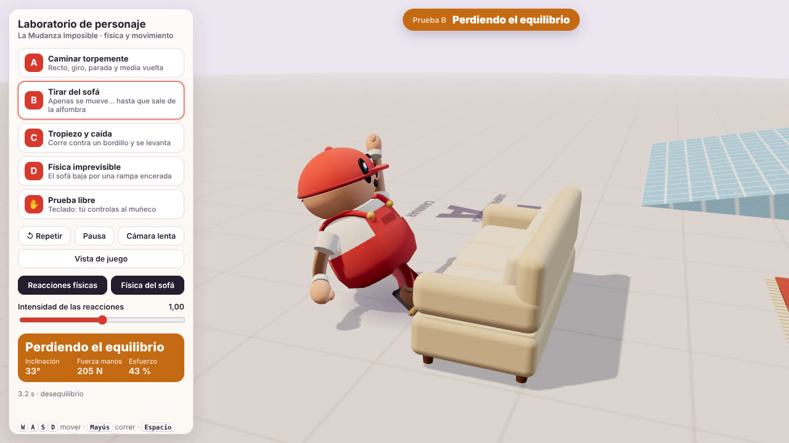

# La Mudanza Imposible · laboratorio de personaje

Demo independiente para diseñar el personaje principal y comprobar si sus movimientos tienen gracia. No toca el juego (`../mudanza-imposible/`) ni comparte código con él: es un banco de pruebas con un muñeco, un sofá y cuatro pruebas de movimiento.



Vídeo de las cuatro pruebas: [`docs/video/laboratorio-personaje.mp4`](docs/video/laboratorio-personaje.mp4) (21,6 s, simulación real a velocidad real).

## Ejecutarlo

Necesitas Node 20 o superior y un navegador con WebGL.

```bash
cd mudanza-imposible-character-lab
npm ci            # instala exactamente las versiones del package-lock
npm run dev       # abre http://localhost:5173
```

Otras órdenes:
- `npm test`: pruebas de la simulación sin navegador (12).
- `npm run build` y luego `npm run preview`: versión de producción en http://localhost:4173.

Para verlo en el móvil, ejecuta `npm run dev` en el ordenador y abre en el teléfono la dirección «Network» que muestra Vite (misma Wi-Fi). Las pruebas A–D se ven con los botones. **No hay controles táctiles**: en el móvil no se puede mover al muñeco a mano.

## Qué se puede hacer

- **Botones A, B, C y D:** reproducen cada prueba desde el mismo estado inicial. El mundo físico se crea de nuevo cada vez, así que la misma prueba con los mismos ajustes da exactamente el mismo resultado y se pueden comparar.
- **Prueba libre:** mueves tú al muñeco con el teclado.
  - Movimiento: `WASD` o las flechas, relativo a la cámara.
  - `Mayús`: correr.
  - `Espacio`: agarrar y soltar.
  - Si tocas el teclado durante una prueba, tomas el control sin reiniciar.
- **Otros controles del panel:**
  - Repetir (`R`), pausa (`P`) y cámara lenta (×0,25).
  - Vista de estudio o vista de juego (cámara alta como en la demo).
  - Ocultar el panel (`H`).
- **Reacciones físicas:** con este control apagado, el muñeco no se desequilibra. Sirve para comparar la misma prueba con y sin reacciones.
- **Física del sofá:** con este control apagado, el sofá queda anclado.
- **Intensidad de las reacciones:** de 0,5 a 1,5. No admite valores fuera de ese margen.
- **Indicador de estado:** estado actual (quieto, caminando, agarrando, tirando, perdiendo el equilibrio, cayendo, levantándose). En el panel, además:
  - inclinación del tronco;
  - fuerza en las manos (N);
  - esfuerzo;
  - últimos sucesos («tropieza», «se le escapa», «cae»…).
- **Cámara:** orbital (arrastrar para girar, rueda para acercar) y sigue al muñeco.

## Las cuatro pruebas

Las pruebas las conduce un guion de entrada: qué teclas «pulsaría» un jugador y cuándo. Lo que pasa después lo decide la física.

| Prueba | Qué hace el guion | Qué pasa y por qué |
|---|---|---|
| **A · Caminar torpemente** | Andar recto, girar, pararse y dar media vuelta. | Los pies se apoyan y dan pasos de verdad: no se desliza. Pasos algo desiguales, pelvis que se mece, brazos al revés que las piernas y cabeza que se adelanta en los giros. Un leve balanceo al arrancar y frenar, porque el modelo no anticipa del todo su propia aceleración. |
| **B · Tirar del sofá** | Agarrar el sofá (95 kg, sobre una alfombra que agarra mucho) y tirar hacia atrás. | **Apenas se mueve**: el esfuerzo sube del 40 % al 100 %, el muñeco se cuelga hacia atrás, entorna los ojos y tiembla, y patalea con pasitos que resbalan. **Al salir el sofá de la alfombra** (suelo liso), la tensión cae de golpe y pierde el equilibrio hacia atrás: pasos apresurados y brazos en molinillo. Con intensidad 0,5 aguanta; con 1, trastabilla y se recupera; con 1,5, se cae de culo. |
| **C · Tropiezo y caída** | Correr contra un bordillo de 16 cm; al levantarse, andar un poco. | El pie se engancha y el cuerpo sigue (giro sobre el apoyo, ω ≈ v/h). Intenta recuperarse con traspiés unos 0,3 s, cae de bruces con una postura asimétrica, se queda en el suelo, se levanta apoyando las manos y vuelve a responder. |
| **D · Física imprevisible** | El sofá baja solo por una rampa encerada (11°, casi sin rozamiento); el muñeco lo agarra cuando le pasa al lado y después lo persigue. | El tirón le pilla sin afianzarse y el sofá gira alrededor de su mano (más de 140°). Se le escapa y se aleja deslizándose. Al perseguirlo, el sofá aún en movimiento le da un empujón y le desequilibra. No hay impulsos inventados: solo la gravedad y la rampa. |

## Cómo está hecho

```
src/sim/       física y estados (sin Three.js: se prueba en Node)
  character.ts porteador: cápsula, control, agarre, equilibrio y máquina de estados
  lab.ts       mundo, sofá (cuerpo compuesto con patas), zonas, guiones de las pruebas
  types.ts
src/view/      dibujo (solo LEE la simulación)
  characterRig.ts  muñeco procedural y su animación
  tube.ts          brazos y piernas de manguera (geometría que se actualiza sin crear objetos)
  sofaView.ts      sofá con las mismas medidas que sus colisionadores
  scene.ts         plató, luces, sombras, cámara orbital
src/main.ts    bucle a 60 Hz fijos, interfaz y ganchos de grabación (?capture=1)
tests/         pruebas de la simulación (Vitest)
scripts/       ejecución sin navegador, capturas y vídeo
```

**Cuerpo físico.** Una cápsula de 75 kg, con la rotación bloqueada mientras está de pie y movida por velocidad objetivo con aceleración máxima. Agarra el sofá con una rótula a la altura a la que lo coge, para tirar sin levantarlo. Las manos aguantan:
- 900 N si está tirando, afianzado;
- 420 N si un tirón le pilla sin afianzarse.

Si se supera, el asa se escapa.

**Equilibrio.** La inclinación del tronco tiene dos partes:
- **La postura que busca:** colgarse en contra de la tensión que espera, o adelantarse al andar.
- **Una desviación involuntaria.** Es un péndulo invertido: la gravedad la agranda y la corrige un control limitado, más fuerte cuando ya está dando pasos.

Qué desequilibra, según la física medida en cada paso:
- La fuerza horizontal sobre el cuerpo se mide por balance de momento: aceleración real menos el empuje del propio control.
- Si actúa en las manos o es un empujón del sofá, desequilibra el tronco. Si es un bordillo, actúa en los pies.
- Mientras tira, la tensión que él mismo genera no le sorprende. Le sorprende que caiga de golpe.

Los estados (`idle`, `walking`, `grabbing`, `pulling`, `losingBalance`, `falling`, `recovering`) salen de esas magnitudes:
- **Desequilibrio:** la desviación supera 0,26 rad.
- **Traspiés:** son pasos reales hacia donde se cae.
- **Caída:** si se pasa de 0,78 rad, la cápsula se desbloquea con la inclinación y el giro que llevaba, y la gravedad la tumba.
- **En el suelo:** roza como un cuerpo.
- **Levantarse:** la cápsula se endereza sobre los pies en 0,85 s y vuelve a ser controlable.

**Vista.** El muñeco no mueve nada físico.
- **Pies:** tienen apoyos fijos en el suelo y dan un paso cuando el cuerpo se aleja (o pataleo rápido si tira sin avanzar).
- **Piernas y brazos:** se resuelven con dos huesos (cadera-rodilla-tobillo, hombro-codo-mano) y se dibujan como tubos curvos.
- **Cara y cabeza:**
  - parpadea;
  - aprieta los ojos con el esfuerzo;
  - abre los ojos y la boca del susto;
  - mira a cámara cuando sufre;
  - la gorra se bambolea.
- **Al caer:** patalea en el aire y acaba en una de tres posturas, que cambian de una caída a otra.

**Sustituirlo por un modelo con esqueleto.** `CharacterRig.sync(lab, dt, camera)` es la única unión con la simulación. Un modelo GLB con huesos puede leer los mismos datos (raíz, inclinación, apoyos de los pies, objetivos de las manos, estado, esfuerzo) y mover sus huesos con el mismo IK.

## Recursos y herramientas

- **Recursos externos:** ninguno. Geometría procedural, texturas dibujadas en canvas y sin sonido.
- **Herramientas de modelado o animación:** comprobé si había alguna en el entorno y no hay ninguna instalada (ni Blender ni conversores glTF). En la sesión hay un servicio externo de generación 3D, pero es de pago; no lo he usado.
- **Dependencias:** las mismas versiones que el juego (Three.js 0.179.1, Rapier 0.19.3, Vite 7, Vitest 4).
  - `npm install` falla en este entorno con un error interno de npm al resolver dependencias entre paquetes (`Cannot read properties of null (reading 'edgesOut')`).
  - Por eso el `package-lock.json` parte del del juego, con las mismas versiones, y se instala con `npm ci`.
  - También se instala `vite-node` (usado por `scripts/run-test.ts`) para que el lockfile coincida.

## Resultados

Todo se ejecutó en este entorno el 19-10-2026: contenedor Linux sin GPU y Chromium con render por software.

| Comprobación | Resultado |
|---|---|
| `npm run typecheck` y `npm run build` | Sin errores. Bundle de unos 2,8 MB (978 kB con gzip), casi todo Three.js y Rapier |
| `npm test` | 12 de 12. Las pruebas comprueban: <br>• Sin vibración ni deriva en reposo. <br>• En A–D: sin valores raros, sin hundirse en el suelo, sin salir disparado, y termina de pie. <br>• La misma prueba se repite idéntica. <br>• A: camina, se para y no se desequilibra él solo. <br>• B: el sofá se mueve menos de 15 cm en el primer segundo de tirón, y el desequilibrio llega cuando sale de la alfombra. Con intensidad 0,5 aguanta; con 1, trastabilla; con 1,5, cae. <br>• C: tropieza, desequilibrio, cae más de 0,25 s después, más de 0,8 s en el suelo, se levanta y vuelve a andar. Sin reacciones, no cae. <br>• D: el sofá gira más de 45°, se le escapa, se aleja más de 1,6 m y luego le desequilibra. |
| Capturas en navegador (`scripts/capture.cjs`) | 14 capturas reales en `docs/capturas/`, sin errores de consola |
| Vídeo (`scripts/record-video.cjs` y `scripts/make-video.sh`) | `docs/video/laboratorio-personaje.mp4`: 21,6 s, 1280×720, H.264, 2,7 MB, sin sonido. Las cuatro pruebas seguidas, grabadas fotograma a fotograma (1/30 s de simulación por fotograma, así que va a velocidad real). Solo se recorta el principio y el final de cada prueba. Los sucesos coinciden con los de Node. |

**Sin medir:** los fotogramas por segundo con una tarjeta gráfica real y el funcionamiento en un móvil. En este contenedor el render es por software y lento, por eso las capturas y el vídeo se hacen en modo `?capture=1`.

Sucesos de la grabación, tal como los registra la simulación:

| Prueba | Sucesos (segundos de prueba) |
|---|---|
| A | ninguno: camina, gira y se para sin desequilibrarse |
| B | 3,2 desequilibrio · 4,5 recupera |
| C | 1,45 tropieza · 1,52 desequilibrio · 1,83 cae · 3,50 se levanta · 4,35 de pie |
| D | 2,05–2,52 se le escapa (tres intentos) · 3,47 desequilibrio · 4,10 recupera · 5,10 desequilibrio (el sofá le empuja) · 5,88 recupera |

## Limitaciones

- **No es un ragdoll.** Al caer, la cápsula física se vuelca de verdad, pero brazos y piernas son dibujados: patalean y acaban en una de tres posturas. No chocan con el suelo y a veces una bota queda apuntando hacia arriba o atraviesa un poco el suelo.
- **El equilibrio es un modelo simplificado,** ajustado para este laboratorio: un péndulo invertido con umbrales, no biomecánica. Funciona bien en estas cuatro situaciones; en otras (golpes laterales fuertes, escaleras) habría que ajustarlo.
- **El muñeco dibujado es algo más ancho que su cápsula** (unos 5 cm). Al pegarse al sofá puede verse un leve contacto visual.
- **Las manos no se cierran sobre el asa.** El agarre es una rótula; las manoplas se colocan en el punto agarrado.
- **En la prueba D pulsa agarrar tres veces seguidas.** El tirón vence la sujeción y el asa se escapa cada vez. Es físico, pero en el registro se ve repetido.
- **En la vista de juego** (cámara alta) el muñeco se reconoce por la gorra roja, pero la cara apenas se ve.
- **Sin sonido.** Ni controles táctiles.
- **No se ha probado con personas.** Que el movimiento haga gracia está por demostrar.

## Próximos ajustes recomendados

1. Verlo con dos o tres personas y apuntar en qué segundo se ríen o no. Es la única forma de saber si funciona.
2. Brazos y piernas físicos solo durante la caída (cadena articulada de Rapier por miembro), para que choquen con el suelo y cada caída sea distinta sin posturas fijas.
3. Sonido de goma: chirrido al tirar, «plof» al caer y pasitos. Pesa mucho en la comedia.
4. Un rebote de la barriga y la cabeza (deformación) en los golpes y al aterrizar.
5. Después, integrar el muñeco en el juego, sustituyendo a un porteador con la misma interfaz `sync()`.
