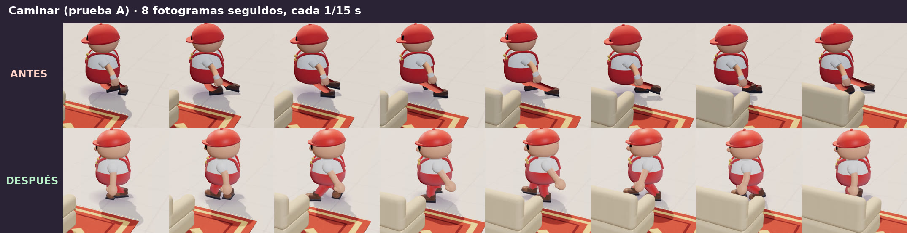

# La Mudanza Imposible · laboratorio de personaje

Demo independiente para diseñar el personaje principal y comprobar si sus movimientos tienen gracia. No toca el juego (`../mudanza-imposible/`) ni comparte código con él: es un banco de pruebas con un muñeco, un sofá y cuatro pruebas de movimiento.


Vídeo de las cuatro pruebas: [`docs/video/laboratorio-personaje.mp4`](docs/video/laboratorio-personaje.mp4) (21,6 s, simulación real a velocidad real, con el muñeco de la iteración 2).

Iteración 2 (aspecto del muñeco y contacto de los pies), con comparaciones antes/después: [más abajo](#iteración-2-aspecto-y-apoyo-de-los-pies).

## Ejecutarlo

Necesitas Node 20 o superior y un navegador con WebGL.

```bash
cd mudanza-imposible-character-lab
npm ci            # instala exactamente las versiones del package-lock
npm run dev       # abre http://localhost:5173
```

Otras órdenes:
- `npm test`: pruebas de la simulación sin navegador (12).
- `npm run build` y luego `npm run preview`: versión de producción en http://localhost:4173.
- Con la versión de producción servida en el puerto 4174 (`npx vite preview --port 4174`) y Playwright instalado:
  - `node scripts/feet-check.cjs <carpeta>`: mide el apoyo de los pies fotograma a fotograma (ver «Iteración 2»).
  - `node scripts/feet-strips.cjs <carpeta>`: guarda tiras de fotogramas seguidos recortadas alrededor del muñeco.

Para verlo en el móvil, ejecuta `npm run dev` en el ordenador y abre en el teléfono la dirección «Network» que muestra Vite (misma Wi-Fi). Las pruebas A–D se ven con los botones. **No hay controles táctiles**: en el móvil no se puede mover al muñeco a mano.

## Qué se puede hacer

- **Botones A, B, C y D:** reproducen cada prueba desde el mismo estado inicial. El mundo físico se crea de nuevo cada vez, así que la misma prueba con los mismos ajustes da exactamente el mismo resultado y se pueden comparar.
- **Prueba libre:** mueves tú al muñeco con el teclado.
  - Movimiento: `WASD` o las flechas, relativo a la cámara.
  - `Mayús`: correr.
  - `Espacio`: agarrar y soltar.
  - Si tocas el teclado durante una prueba, tomas el control sin reiniciar.
- **Otros controles del panel:**
  - Repetir (`R`), pausa (`P`) y cámara lenta (×0,25).
  - Vista de estudio o vista de juego (cámara alta como en la demo).
  - Ocultar el panel (`H`).
- **Reacciones físicas:** con este control apagado, el muñeco no se desequilibra. Sirve para comparar la misma prueba con y sin reacciones.
- **Física del sofá:** con este control apagado, el sofá queda anclado.
- **Intensidad de las reacciones:** de 0,5 a 1,5. No admite valores fuera de ese margen.
- **Indicador de estado:** estado actual (quieto, caminando, agarrando, tirando, perdiendo el equilibrio, cayendo, levantándose). En el panel, además:
  - inclinación del tronco;
  - fuerza en las manos (N);
  - esfuerzo;
  - últimos sucesos («tropieza», «se le escapa», «cae»…).
- **Cámara:** orbital (arrastrar para girar, rueda para acercar) y sigue al muñeco.

## Las cuatro pruebas

Las pruebas las conduce un guion de entrada: qué teclas «pulsaría» un jugador y cuándo. Lo que pasa después lo decide la física.

| Prueba | Qué hace el guion | Qué pasa y por qué |
|---|---|---|
| **A · Caminar torpemente** | Andar recto, girar, pararse y dar media vuelta. | Los pies se apoyan y dan pasos de verdad: no se desliza. Pasos algo desiguales, pelvis que se mece, brazos al revés que las piernas y cabeza que se adelanta en los giros. Un leve balanceo al arrancar y frenar, porque el modelo no anticipa del todo su propia aceleración. |
| **B · Tirar del sofá** | Agarrar el sofá (95 kg, sobre una alfombra que agarra mucho) y tirar hacia atrás. | **Apenas se mueve**: el esfuerzo sube del 40 % al 100 %, el muñeco se cuelga hacia atrás, entorna los ojos y tiembla, y patalea con pasitos que resbalan. **Al salir el sofá de la alfombra** (suelo liso), la tensión cae de golpe y pierde el equilibrio hacia atrás: pasos apresurados y brazos en molinillo. Con intensidad 0,5 aguanta; con 1, trastabilla y se recupera; con 1,5, se cae de culo. |
| **C · Tropiezo y caída** | Correr contra un bordillo de 16 cm; al levantarse, andar un poco. | El pie se engancha y el cuerpo sigue (giro sobre el apoyo, ω ≈ v/h). Intenta recuperarse con traspiés unos 0,3 s, cae de bruces con una postura asimétrica, se queda en el suelo, se levanta apoyando las manos y vuelve a responder. |
| **D · Física imprevisible** | El sofá baja solo por una rampa encerada (11°, casi sin rozamiento); el muñeco lo agarra cuando le pasa al lado y después lo persigue. | El tirón le pilla sin afianzarse y el sofá gira alrededor de su mano (más de 140°). Se le escapa y se aleja deslizándose. Al perseguirlo, el sofá aún en movimiento le da un empujón y le desequilibra. No hay impulsos inventados: solo la gravedad y la rampa. |

## Cómo está hecho

```
src/sim/       física y estados (sin Three.js: se prueba en Node)
  character.ts porteador: cápsula, control, agarre, equilibrio y máquina de estados
  lab.ts       mundo, sofá (cuerpo compuesto con patas), zonas, guiones de las pruebas
  types.ts
src/view/      dibujo (solo LEE la simulación)
  characterRig.ts  muñeco procedural y su animación
  tube.ts          brazos y piernas de manguera (geometría que se actualiza sin crear objetos)
  sofaView.ts      sofá con las mismas medidas que sus colisionadores
  scene.ts         plató, luces, sombras, cámara orbital
src/main.ts    bucle a 60 Hz fijos, interfaz y ganchos de grabación (?capture=1)
tests/         pruebas de la simulación (Vitest)
scripts/       ejecución sin navegador, capturas y vídeo
```

**Cuerpo físico.** Una cápsula de 75 kg, con la rotación bloqueada mientras está de pie y movida por velocidad objetivo con aceleración máxima. Agarra el sofá con una rótula a la altura a la que lo coge, para tirar sin levantarlo. Las manos aguantan:
- 900 N si está tirando, afianzado;
- 420 N si un tirón le pilla sin afianzarse.

Si se supera, el asa se escapa.

**Equilibrio.** La inclinación del tronco tiene dos partes:
- **La postura que busca:** colgarse en contra de la tensión que espera, o adelantarse al andar.
- **Una desviación involuntaria.** Es un péndulo invertido: la gravedad la agranda y la corrige un control limitado, más fuerte cuando ya está dando pasos.

Qué desequilibra, según la física medida en cada paso:
- La fuerza horizontal sobre el cuerpo se mide por balance de momento: aceleración real menos el empuje del propio control.
- Si actúa en las manos o es un empujón del sofá, desequilibra el tronco. Si es un bordillo, actúa en los pies.
- Mientras tira, la tensión que él mismo genera no le sorprende. Le sorprende que caiga de golpe.

Los estados (`idle`, `walking`, `grabbing`, `pulling`, `losingBalance`, `falling`, `recovering`) salen de esas magnitudes:
- **Desequilibrio:** la desviación supera 0,26 rad.
- **Traspiés:** son pasos reales hacia donde se cae.
- **Caída:** si se pasa de 0,78 rad, la cápsula se desbloquea con la inclinación y el giro que llevaba, y la gravedad la tumba.
- **En el suelo:** roza como un cuerpo.
- **Levantarse:** la cápsula se endereza sobre los pies en 0,85 s y vuelve a ser controlable.

**Vista.** El muñeco no mueve nada físico.
- **Pies (planificador de pasos):** cada pie apoyado no se mueve. Da un paso cuando se queda media zancada por detrás de la cadera, cuando la pierna se estira de más, si ha quedado en el lado equivocado (cruce) o si el cuerpo ha girado mucho. Aterriza donde estará la cadera al aterrizar más media zancada, y el destino se corrige en el aire si el cuerpo acelera o frena. Zancada y duración del paso dependen de la velocidad real. Tirando sin avanzar, pataleo corto que resbala.
- **Contacto con el suelo:** la suela se inclina con el suelo (rampa) y, en cada fotograma, se sube lo justo para que ningún punto de la suela quede por debajo del suelo (también al despegar el talón).
- **Piernas y brazos:** se resuelven con dos huesos (cadera-rodilla-tobillo, hombro-codo-mano) y se dibujan como tubos curvos. La rodilla apunta hacia la punta del pie y, si tiene que cambiar de lado, gira por fuera con velocidad limitada.
- **Cara y cabeza:**
  - parpadea;
  - aprieta los ojos con el esfuerzo;
  - abre los ojos y la boca del susto;
  - mira a cámara cuando sufre;
  - la gorra se bambolea.
- **Al caer:** tobillos y manos pasan a ser partículas con gravedad e inercia, atadas a cadera y hombros y que chocan con el suelo. Patalean en el aire y se quedan donde caen, así que cada caída deja una postura distinta. Al levantarse, los pies salen de donde están dibujados y los pasos normales los recogen.

**Sustituirlo por un modelo con esqueleto.** `CharacterRig.sync(lab, dt, camera)` es la única unión con la simulación. Un modelo GLB con huesos puede leer los mismos datos (raíz, inclinación, apoyos de los pies, objetivos de las manos, estado, esfuerzo) y mover sus huesos con el mismo IK.

## Recursos y herramientas

- **Recursos externos:** ninguno. Geometría procedural, texturas dibujadas en canvas y sin sonido.
- **Herramientas de modelado o animación:** comprobé si había alguna en el entorno y no hay ninguna instalada (ni Blender ni conversores glTF). En la sesión hay un servicio externo de generación 3D, pero es de pago; no lo he usado.
- **Dependencias:** las mismas versiones que el juego (Three.js 0.179.1, Rapier 0.19.3, Vite 7, Vitest 4).
  - `npm install` falla en este entorno con un error interno de npm al resolver dependencias entre paquetes (`Cannot read properties of null (reading 'edgesOut')`).
  - Por eso el `package-lock.json` parte del del juego, con las mismas versiones, y se instala con `npm ci`.
  - También se instala `vite-node` (usado por `scripts/run-test.ts`) para que el lockfile coincida.

## Iteración 2: aspecto y apoyo de los pies

### Qué ha cambiado en el muñeco

Misma identidad (muñeco de goma, gorra roja, camiseta clara, peto rojo). Revisado de cerca, de frente, de lado y de espaldas, antes de cambiar nada. Lo que se veía mal y cómo queda:

| Antes | Ahora |
|---|---|
| La gorra tapaba media cabeza: **los ojos quedaban pintados sobre la gorra** y la visera parecía un pico. | Gorra sobre la coronilla, visera por encima de los ojos. Cara legible: ojos con brillo, cejas que reaccionan (fruncidas al tirar, levantadas del susto), nariz, colorete y boca en apuros. |
| **Los tubos de brazos y piernas se dibujaban del revés** (caras hacia dentro). Solo se veía su pared trasera: piernas oscuras y finas, y un brazo pegado a la barriga «desaparecía». | Caras hacia fuera: miembros con volumen e iluminación correctos. |
| Tronco hasta la cadera: las piernas apenas asomaban 12 cm. Cuello en pico y puño blanco suelto en la muñeca. | Tronco continuo hasta el cuello (cuello de camiseta que une cabeza y cuerpo), peto con perneras de las que salen las piernas, sin aro en la cintura. Piernas visibles (~20 cm), más gruesas. |
| Manos pequeñas y botas planas. | Manoplas grandes con pulgar. Botas de trabajo con suela, puntera y caña. |
| Luz de relleno fija: de espaldas a ella, piernas y cara en sombra. | Hemisférica algo más fuerte y un relleno suave que acompaña a la cámara. |

Materiales con brillo de goma (capa transparente) y tela con reflejo suave. Todo sigue siendo geométrico y procedural, sin recursos externos.



### Contacto de los pies

Primero se midió cómo estaba (`scripts/feet-check.cjs`): 60 fotogramas por segundo de simulación, con las cuatro esquinas de cada suela y la altura real del suelo bajo cada una. Las causas encontradas:

- **La pierna de atrás se estiraba muchísimo.** El destino del paso se fijaba al despegar y no tenía en cuenta lo que avanzaba el cuerpo durante el paso.
- **Suelas hundidas.** En la rampa, la bota no se inclinaba con el suelo. Al despegar, el talón giraba sobre el centro y la puntera entraba en el suelo.
- **Piernas cruzadas al levantarse.** Los pies empezaban en la postura de tumbado.
- **Rodillas que saltaban de lado.** El polo de la rodilla iba atado al tronco inclinado.

Se ha resuelto en la vista, sin congelar los pies ni frenar al muñeco: la física y sus reacciones son las mismas (los 12 tests pasan sin cambiar un número). El funcionamiento está en «Cómo está hecho → Vista».

Mismas pruebas, mismos tramos, mismo método (después de corregir la medición de la rodilla para usar el tobillo real en las dos versiones):

| Tramo | Hundimiento de la suela | Cruces de piernas | Saltos de rodilla | Deslizamiento en apoyo | Zancada media |
|---|---|---|---|---|---|
| Caminar y parar (A) | 3 % de fotogramas, máx. 2 cm → **0** | 6,2 % → **1,2 %** | 0 → 0 | 0 → 0 | 0,62 → 0,68 m a 1,06 m/s |
| Tirar del sofá (B) | 4,7 %, máx. 2,5 cm → **0** | 0,8 % → **0** | 0 → 0 | 3,4 → **0,7 cm/s** (resbalón buscado) | 0,28 → 0,43 m (6,9 → 4,4 pasos/s) |
| Tropezar y caer (C) | 10,7 %, máx. **16 cm** → **0** | 0 → 0 | 0 → **1** | 0 → 0 | — |
| Levantarse (C) | 0 → 0 | **24,3 %** → **4,1 %** | 0 → 0 | 0 → 1,8 cm/s (al apoyar) | — |
| Rampa (D) | **27,5 %**, máx. 5,8 cm → **0** | 6 % → **0** | 0 → 0 | 0 → 0 | 0,46 → 0,62 m |

«Pie flotando» (suela apoyada a más de 3 cm del suelo): 0 en todos los tramos, antes y después. Un «salto de rodilla» es un cambio de más de 60° en la dirección de la rodilla de un fotograma al siguiente.

Tiras de 8 fotogramas seguidos, antes y después, recortadas alrededor del muñeco (`scripts/feet-strips.cjs`):

- [Caminar](docs/capturas/iteracion2/pies-1-caminar.jpg) · [Llegar y pararse](docs/capturas/iteracion2/pies-2-parar.jpg)
- [Tirar del sofá](docs/capturas/iteracion2/pies-3-tirar.jpg) · [Se suelta de golpe](docs/capturas/iteracion2/pies-4-se-suelta.jpg)
- [Tropieza](docs/capturas/iteracion2/pies-5-tropezar.jpg) · [Cae](docs/capturas/iteracion2/pies-6-caer.jpg) · [Se levanta](docs/capturas/iteracion2/pies-7-levantarse.jpg)
- [Rampa](docs/capturas/iteracion2/pies-8-rampa.jpg) · [El muñeco de frente, de lado y de espaldas](docs/capturas/iteracion2/muneco-antes-despues.jpg)

### Lo que sigue sin estar bien

- **Al soltarse el sofá de golpe** (B, 3,1–3,6 s), el cuerpo sale hacia atrás más rápido de lo que alternan los pasos y la pierna delantera se estira mucho, como goma. Para una caída es aceptable; para unos traspiés, es demasiado. Solución concreta: en desequilibrio, permitir dar el paso con el pie más alejado aunque el otro no haya aterrizado (saltitos), y limitar el estiramiento a un 30 % de la pierna.
- **Una rodilla cambia de lado de golpe** justo antes de caer de bruces (C, 1,80 s; un fotograma).
- **Al levantarse,** los pies se colocan en 0,15 s desde donde estaban tumbados. Ese ajuste cuenta como 1,8 cm/s de deslizamiento. En un 4 % de los fotogramas del tramo, los pies quedan juntos o apenas cruzados.
- **En el suelo,** los miembros son partículas, no una cadena articulada: las rodillas no chocan con el suelo, solo tobillos y manos.
- **Las piernas tienen forma de C** (manguera) y no hay pie que «empuje» del suelo: el paso es un arco.

**Sonido:** el laboratorio no tiene sonido; no lo tenía en la iteración 1 y tampoco se ha añadido. No había sonidos que conservar.

## Resultados

Todo se ejecutó en este entorno el 19-10-2026 (iteraciones 1 y 2): contenedor Linux sin GPU y Chromium con render por software.

| Comprobación | Resultado |
|---|---|
| `npm run typecheck` y `npm run build` | Sin errores. Bundle de unos 2,8 MB (978 kB con gzip), casi todo Three.js y Rapier |
| `npm test` | 12 de 12. Las pruebas comprueban: <br>• Sin vibración ni deriva en reposo. <br>• En A–D: sin valores raros, sin hundirse en el suelo, sin salir disparado, y termina de pie. <br>• La misma prueba se repite idéntica. <br>• A: camina, se para y no se desequilibra él solo. <br>• B: el sofá se mueve menos de 15 cm en el primer segundo de tirón, y el desequilibrio llega cuando sale de la alfombra. Con intensidad 0,5 aguanta; con 1, trastabilla; con 1,5, cae. <br>• C: tropieza, desequilibrio, cae más de 0,25 s después, más de 0,8 s en el suelo, se levanta y vuelve a andar. Sin reacciones, no cae. <br>• D: el sofá gira más de 45°, se le escapa, se aleja más de 1,6 m y luego le desequilibra. |
| Capturas en navegador (`scripts/capture.cjs`) | 14 capturas reales en `docs/capturas/` (rehechas con el muñeco nuevo), sin errores de consola |
| Pies (`scripts/feet-check.cjs`, `scripts/feet-strips.cjs`) | Métricas y tiras antes/después en «Iteración 2»; 0 errores de consola |
| Controles del laboratorio (navegador, modo normal) | Botones A–D, repetir, pausa (congela la simulación), cámara lenta, vista de juego, reacciones, física del sofá, intensidad (1,5 → «1,50») y teclado (W pasa a prueba libre y lo mueve): todos responden, sin errores |
| Vídeo (`scripts/record-video.cjs` y `scripts/make-video.sh`) | `docs/video/laboratorio-personaje.mp4`: 21,6 s, 1280×720, H.264, 2,6 MB, sin sonido. Las cuatro pruebas seguidas, grabadas fotograma a fotograma (1/30 s de simulación por fotograma, así que va a velocidad real). Solo se recorta el principio y el final de cada prueba. Los sucesos coinciden con los de Node. |

**Sin medir:** los fotogramas por segundo con una tarjeta gráfica real y el funcionamiento en un móvil. En este contenedor el render es por software y lento, por eso las capturas y el vídeo se hacen en modo `?capture=1`.

Sucesos de la grabación, tal como los registra la simulación. Son idénticos en las dos iteraciones: la iteración 2 no toca la física.

| Prueba | Sucesos (segundos de prueba) |
|---|---|
| A | ninguno: camina, gira y se para sin desequilibrarse |
| B | 3,2 desequilibrio · 4,5 recupera |
| C | 1,45 tropieza · 1,52 desequilibrio · 1,83 cae · 3,50 se levanta · 4,35 de pie |
| D | 2,05–2,52 se le escapa (tres intentos) · 3,47 desequilibrio · 4,10 recupera · 5,10 desequilibrio (el sofá le empuja) · 5,88 recupera |

## Limitaciones

- **No es un ragdoll.** Al caer, la cápsula física se vuelca de verdad. Brazos y piernas son dibujados: tobillos y manos son partículas que caen y chocan con el suelo, pero no empujan la cápsula ni tienen articulaciones con límites.
- **Los pies los coloca la vista,** no la física. Son coherentes con la velocidad y el suelo reales, pero no transmiten fuerza: la cápsula no «sabe» dónde pisa cada pie.
- **El equilibrio es un modelo simplificado,** ajustado para este laboratorio: un péndulo invertido con umbrales, no biomecánica. Funciona bien en estas cuatro situaciones; en otras (golpes laterales fuertes, escaleras) habría que ajustarlo.
- **El muñeco dibujado es algo más ancho que su cápsula** (unos 5 cm). Al pegarse al sofá puede verse un leve contacto visual.
- **Las manos no se cierran sobre el asa.** El agarre es una rótula; las manoplas se colocan en el punto agarrado.
- **En la prueba D pulsa agarrar tres veces seguidas.** El tirón vence la sujeción y el asa se escapa cada vez. Es físico, pero en el registro se ve repetido.
- **En la vista de juego** (cámara alta) el muñeco se reconoce por la gorra roja, pero la cara apenas se ve.
- **Sin sonido** y sin controles táctiles.
- **No se ha probado con personas.** Que el movimiento haga gracia está por demostrar.

## Próximos ajustes recomendados

1. Verlo con dos o tres personas y apuntar en qué segundo se ríen o no. Es la única forma de saber si funciona.
2. Traspiés con pasos que no esperan al otro pie y estiramiento de pierna limitado (ver «Lo que sigue sin estar bien»).
3. Brazos y piernas físicos solo durante la caída (cadena articulada de Rapier por miembro), para que también las rodillas y los codos choquen con el suelo.
4. Sonido de goma: chirrido al tirar, «plof» al caer y pasitos. Pesa mucho en la comedia.
5. Un rebote de la barriga y la cabeza (deformación) en los golpes y al aterrizar.
6. Después, integrar el muñeco en el juego, sustituyendo a un porteador con la misma interfaz `sync()`.
