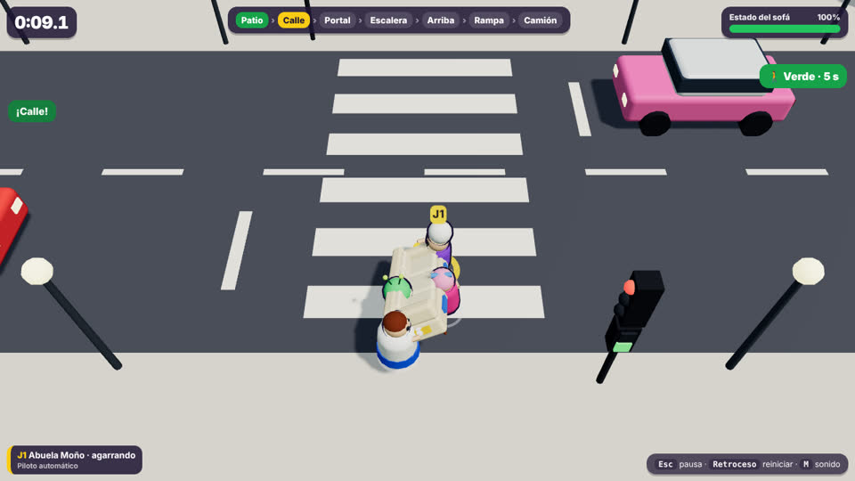

# La Mudanza Imposible · vertical slice físico

Demo jugable en el navegador. Entre varios porteadores hay que llevar un sofá desde una casa hasta un camión de mudanzas. Por el camino hay una calle con tráfico, una puerta estrecha, una escalera con giro de 90° y una rampa de chapa sin barandilla.

Todo lo que ocurre sale de la simulación física (Rapier). No hay animaciones prefabricadas que muevan el sofá.



Todas las capturas de `docs/capturas/` son reales: Chromium sin interfaz con render por software.

## Cómo jugar en 1 minuto

```bash
cd mudanza-imposible
npm install
npm run dev          # abre http://localhost:5173
```

1. En el menú, pulsa **Intro** o «¡A mover!».
2. Acércate al sofá con **WASD**, agárralo con **Espacio** y llévalo hacia arriba de la pantalla.
3. La flecha amarilla marca el siguiente objetivo.

Para ver una partida completa sin tocar nada, usa «Ver demo automática» o abre `http://localhost:5173/?auto=1`.

Requisitos: Node 20 o superior y un navegador con WebGL (Chrome, Edge o Firefox). No hay servicios externos ni de pago.

Versión de producción: `npm run build` y después `npm run preview`, que sirve en `http://localhost:4173`.

## Controles

| Acción | J1 (teclado) | J2 (teclado) | Mando (J1–J4) |
|---|---|---|---|
| Moverse | W A S D | Flechas | Stick izquierdo o cruceta |
| Agarrar / soltar | Espacio | Intro | A |
| Alzar (mantener) | Mayús izq. | Mayús dcha. | B o gatillos |
| Girar el sofá (tú y tus ayudantes) | Q / E | , / . | LB / RB |
| Enderezar el sofá volcado | R | - | Y |
| Pausa | Esc | | Start |
| Reiniciar | Retroceso | | Start (en resultados) |
| Silenciar | M | | |

**Objetivo:** dejar el sofá en la zona amarilla junto al camión en menos de 3 minutos, sin que su estado llegue a 0 %.

**Estrellas:**
- una por entregar;
- otra si tardas 90 s o menos;
- otra si el sofá llega con un 70 % o más.

**Qué daña el sofá:**

| Causa | Daño |
|---|---|
| Golpe o caída brusca | Proporcional a la violencia |
| Atropello | −12 % |
| Enderezarlo | −3 % |
| Caer fuera del mapa | −15 %, +5 s y reaparece en el último punto |

## El recorrido

| Etapa | Qué pone a prueba |
|---|---|
| Patio | Agarrar y coordinarse. El sofá sale atravesado: hay que girarlo. |
| Calle | Dos carriles con coches y un semáforo cuyo ciclo es: verde para coches 8 s, ámbar 1,6 s, rojo total 1,4 s, verde para peatones 6 s. Si algo se queda en la calzada, los coches pitan, frenan a 3,2 m/s y lo empujan. |
| Portal | Puerta de 1,6 m. El sofá mide 2,2 × 0,9 m: solo pasa de largo, y los porteadores de los lados chocan con el marco. |
| Escalera | Rampa de 20° con peldaños visuales. Arriba, un rellano obliga a girar 90°. |
| Pasillo de arriba y terraza | Paredes que se vuelven translúcidas para no tapar la acción. |
| Rampa | Chapa resbaladiza, 17° y sin barandilla. Si soltáis el sofá, baja deslizándose; si se cae por un lado, recibe daño (y a veces ahorra camino). |
| Entrega | El sofá tiene que reposar dentro de la zona 1 s. |

## Decisiones técnicas

- **Stack:** Vite 7, TypeScript, Three.js 0.179 y Rapier 0.19 (`rapier3d-compat`, WASM).
  - El repositorio solo tenía el motor por turnos de «A la de tres», que no sirve para física en tiempo real. Lo he dejado intacto en `../a-la-de-tres/` y he creado esta demo aislada.
  - Rapier es determinista, rápido (unos 0,1–0,16 ms por paso con 2–6 porteadores) y funciona igual en Node que en el navegador, así que la física se puede probar sin interfaz.
- **Simulación separada del dibujo:** `src/sim/` no importa Three.js ni el DOM. El bucle del navegador avanza la física a paso fijo (60 Hz) y luego dibuja.
- **Agarre:** articulación de rótula entre la mano del porteador y el punto del sofá que agarra.
  - Por eso el sofá gira, se inclina o se atasca según desde dónde y hacia dónde tira cada uno.
  - La mano empieza en el punto agarrado y sube a su altura a 1,4 m/s, para evitar tirones.
  - Si la mano y el punto se separan más de 0,55 m (dos personas tirando en sentidos opuestos, un golpe), el agarre se suelta («¡Se escapa!»).
- **Muñecas:** una rótula no hace par, así que con dos personas por los extremos el sofá giraba sobre su eje largo sin parar. He añadido un par estabilizador proporcional al número de manos. Deja inclinarlo, pero no voltearlo con facilidad. Es una ayuda física deliberada y está documentada en `game.ts` (`wristAssist`).
- **Porteadores:** cápsulas dinámicas con rotación bloqueada, controladas por velocidad objetivo con una aceleración máxima. Así responden al instante, pero pueden ser arrastrados por el sofá o por otros.
- **Recuperación sin reiniciar:**
  - **R** endereza el sofá.
  - Si cae fuera del mapa, reaparece en el último punto.
  - Un porteador que se queda lejos vuelve junto al sofá.
  - Se limitan las velocidades extremas del sofá para que un conflicto del solver no lo lance por los aires.
- **Ayudantes de la máquina** (`bots.ts`): son deliberadamente simples.
  - Van a un asa libre e imitan, con 0,17 s de retraso, cómo se mueven los humanos que cargan.
  - Acompañan los giros que se piden con Q/E.
  - Si empujan contra algo sin avanzar, sueltan el asa y vuelven a agarrar al poco. Así pasan la puerta.
  - En modo «Despistados» reaccionan más tarde y se desvían.
- **Piloto automático** (`autopilot.ts`): conoce la ruta y lleva al jugador 1. Sirve para el modo demo y para comprobar con la física real que el nivel se puede completar. No es una IA de juego.
- **Cámara:** cenital oblicua (unos 52°) con el norte siempre arriba, centrada en el sofá con un poco de adelanto y de peso hacia los humanos.
  - Se aleja si el grupo se dispersa.
  - Las paredes que tapan la acción se vuelven translúcidas.
  - No gira, para que las direcciones de los controles no cambien y quien mira una grabación entienda el recorrido como en un mapa.
- **Aspecto:** todo es geometría procedural (sin modelos ni texturas de terceros), con un estilo de juguete coherente con el concepto visual previo: abuelas, enano, gordo, alien y perro salchicha, y sofá crema con asas rojas y azules.
- **Sonido:** sintetizado con WebAudio, sin archivos.

## Estructura

```
mudanza-imposible/
  index.html            menú, interfaz, pausa y resultados (DOM + CSS)
  src/main.ts           bucle de juego, menú, eventos → sonido/efectos/mensajes
  src/sim/              simulación (sin Three.js)
    level.ts            geometría del recorrido, etapas y puntos de paso
    sofa.ts             cuerpo del sofá, asas y utilidades de rotación
    carrier.ts          porteador: movimiento, agarre, alzar, soltar
    traffic.ts          coches, carriles y semáforo
    bots.ts             ayudantes de la máquina
    autopilot.ts        piloto automático (demo y pruebas)
    game.ts             estado de la partida, daños, recuperación, victoria/derrota
  src/view/             dibujo con Three.js (escena, sofá, personajes, coches, efectos, cámara)
  src/input/input.ts    teclado (2 jugadores) y mandos (hasta 4)
  src/audio/sfx.ts      sonidos sintetizados
  src/ui/hud.ts         interfaz durante la partida
  tests/sim.test.ts     pruebas de la física sin navegador (Vitest)
  scripts/              simulación por consola, rendimiento y pruebas en Chromium
  docs/capturas/        capturas reales
```

## Pruebas ejecutadas y resultados reales

Todas se ejecutaron en este entorno (contenedor Linux sin GPU) el 18-10-2026.

### 1. `npm test`: 18 de 18 pruebas pasan

| Grupo | Qué comprueban |
|---|---|
| Sofá y agarre | En reposo no se mueve ni vibra (<2 cm en 3 s). Los ayudantes agarran y, con el jugador, levantan el sofá (>0,6 m) y lo sacan del patio. Agarrar y soltar funcionan. |
| Puerta estrecha | De lado se queda en la fachada; de largo pasa. |
| Tráfico | El semáforo da paso a los peatones solo después del ámbar y del rojo total. Un coche pita, golpea, daña (−12 %) y desplaza el sofá que está en su carril. Un porteador atropellado queda mareado. |
| Recuperación | Enderezar. Reaparecer al caer fuera del mapa (−15 %). Un porteador perdido vuelve junto al sofá. |
| Partida completa | Con el piloto automático se entrega el sofá con 2 porteadores atentos, 4 atentos y 4 despistados, pasando por todas las etapas en orden. Se pierde al agotar el tiempo. |
| Rampa | Un sofá soltado en la chapa resbala más de 2,5 m. |
| Datos del nivel | Todas las cajas tienen dimensiones válidas. |

### 2. `npm run sim`: piloto automático con física real, configuraciones variadas

| Porteadores | Ayudantes | Resultado | Tiempo | Estado del sofá |
|---|---|---|---|---|
| 2 | atentos | entregado | 35,6 s | 100 % |
| 3 | atentos | entregado | 36,0 s | 100 % |
| 4 | atentos | entregado | 36,0 s | 100 % |
| 4 | despistados | entregado | 46,5 s | 97 % |
| 4 | despistados | entregado | 62,6 s | 99 % |
| 5 | atentos | entregado | 102,4 s | 100 % |
| 6 | despistados | entregado | 77,7 s | 81 % |
| 6 | atentos (semilla 1) | **tiempo agotado** | 180 s | — |

El último caso es la última medición de una configuración que, en ejecuciones anteriores de la sesión, a veces sí se completaba. Con 6 porteadores el grupo es muy ancho y el piloto automático se atasca girando en el rellano.

### 3. Pruebas en Chromium (Playwright, render por software)

| Prueba | Resultado |
|---|---|
| `e2e:smoke` (demo automática con 4 porteadores) | La partida se completa en 36,0 s con el sofá al 100 %. Sin errores de página. Queda un aviso benigno de la propia Rapier («deprecated parameters»). Unas 114 llamadas de dibujo y 18 000 triángulos por fotograma. |
| `e2e:teclado` (teclas reales) | Agarrar con Espacio, que los ayudantes agarren, llevar el sofá con W (2,7–3,4 m), levantarlo (0,82 m), girarlo con Q (0,48 rad), alzarlo con Mayús (+0,56 m), soltarlo, pausar con Esc y reiniciar con Retroceso. Todo OK en las 2 últimas ejecuciones. En una ejecución anterior falló una vez el paso «avanzar con W» (Δz = 0, con solo 3 manos agarradas) y no se ha reproducido: ni en 5 ejecuciones más, ni en 36 simulaciones sin interfaz que lo buscaban. |
| `e2e:dos` (dos jugadores en el mismo teclado, sin ayudantes) | Los dos agarran, avanzan juntos (2,1–2,9 m) y, si tiran en direcciones opuestas, el sofá gira por pura física (1,2–1,4 rad). |

Para ejecutarlas hace falta Playwright con Chromium, que no está en las dependencias. Con la demo servida en el puerto 4173:

```bash
NODE_PATH=$(npm root -g) npm run e2e:teclado
```

### Rendimiento

| Medida | Valor |
|---|---|
| Física (`npm run perf`) | 0,11 ms por paso con 2–4 porteadores y 0,16 ms con 6 (el presupuesto es de 16,7 ms) |
| Imagen en este contenedor | Unos 11 fps por render por software, sin GPU |

**No he podido medir los fps con una tarjeta gráfica real.** Por el número de llamadas de dibujo debería ir fluido en un ordenador normal, pero queda por comprobar.

## Qué está hecho, qué es provisional y qué no existe

**Implementado y probado**
- Partida completa: inicio con cuenta atrás, recorrido, victoria y derrota (destrozado o tiempo), resultados, reinicio instantáneo y pausa.
- Sofá físico:
  - colisiona, se atasca en la puerta y se inclina si una parte alza y otra no;
  - cae si se suelta y resbala por la rampa;
  - se daña con golpes, caídas y atropellos (con parches de cinta visibles).
- Porteadores con agarre por rótula, alzar, soltar, mareo por atropello y retorno si se pierden.
- Tráfico en movimiento con semáforo, frenada, pitidos y empujones.
- 1 jugador con 1–5 ayudantes; 2 jugadores en un teclado; mandos para J1–J4.
- Interfaz:
  - tiempo, etapas y estado del sofá;
  - avisos de vuelco y atasco, y semáforo de peatones;
  - mensajes de eventos y flecha al siguiente objetivo;
  - menú y resultados con estrellas y mejor tiempo.
- Sonidos de agarre, soltar, golpe, atropello, pitido, mareo, etapa, victoria y derrota.

**Provisional**
- La «inteligencia» de los ayudantes: imitan al jugador y no toman decisiones propias.
- La ayuda de muñecas y sus constantes: `RULES.wristK`, `wristDamp` y los umbrales de daño, sin ajustar con jugadores.
- Los mandos están implementados con la asignación estándar, pero **no se han probado con un mando físico**. Las pruebas automáticas solo usan teclado.
- Las animaciones son procedurales y sencillas (balanceo al andar, brazos hacia el agarre, mareo). No hay animación esquelética ni caídas tipo muñeco de trapo.
- La escalera física es una rampa lisa con peldaños dibujados encima.

**No existe todavía**
- Multijugador en red, servidores o cuentas (fuera de alcance, a propósito).
- Más de 4 jugadores humanos (el motor admite 6 porteadores).
- Más niveles o muebles, y obstáculos móviles distintos de los coches.
- Repeticiones o cámara de espectador, y música.

## Evaluación crítica del potencial de diversión

Las comprobaciones de arriba son técnicas. Que la demo sea divertida es una **hipótesis sin validar: nadie la ha jugado todavía**.

| Pregunta | Lo que sé y lo que no |
|---|---|
| ¿Qué puede hacer divertido el movimiento? | Que el sofá responda a dónde y hacia dónde tira cada persona: dos personas que no se ponen de acuerdo lo hacen girar (comprobado en `e2e:dos`), y uno que alza sin el otro lo inclina. La gracia depende de que esa causa se vea y se entienda; los brazos, los puntos de agarre de colores y el aro rojo de vuelco intentan que se vea. Falta comprobarlo con gente. |
| ¿Qué momentos inesperados pueden surgir? | Un atropello en mitad del paso de cebra. El sofá atravesado contra el marco de la puerta. El grupo que suelta en la rampa y ve el sofá bajar solo. Caerse por el lado de la rampa, que daña pero acorta camino. Un porteador atropellado que suelta y desequilibra al resto. Los he visto aparecer en las simulaciones, no en partidas humanas. |
| ¿Qué decisiones toma el jugador? | Esperar al semáforo o arriesgarse; por qué lado agarrar; cuándo soltar para pasar la puerta; cuándo girar en la escalera; ir por la rampa con cuidado o saltar por el lado. |
| ¿Qué errores pueden parecer injustos? | Que se escape el agarre sin entender por qué (hay aviso, pero hay que verlo con gente). Que un ayudante de la máquina empuje mal. Atropellos que no se vieron venir: hay pitido y aviso, pero a 10 m/s es poco margen. |
| ¿Qué momentos dan clip? | Atropellos, el sofá resbalando por la rampa y atascos en la puerta. |
| ¿Qué puede aburrir? | Con 1 jugador y ayudantes, el núcleo social (discutir y coordinarse) **no existe**: los ayudantes copian lo que haces. El patio y el pasillo superior son tramos de transición sin decisión. El recorrido completo dura solo 36 s con el piloto automático y algo más con personas; puede quedarse corto. |

**Lo que la demo no valida:** la diversión con amigos reales, la comunicación por voz, el caos de 4–10 personas y la comprensión de los controles por alguien nuevo. Para eso hacen falta sesiones con personas.

## Tres mejoras prioritarias para la siguiente iteración

1. **Probarla con 2–4 personas en un mismo ordenador**, con teclado y mandos, y grabar las sesiones. Antes de añadir nada, hay que medir dónde se ríen, dónde se frustran y si entienden por qué gira o se escapa el sofá.
2. **Agarre más expresivo y más legible:** que se vea cuánta fuerza hace cada uno (barras o tensión visible en los brazos), un «tirón» corto y que alzar y bajar se note más. Es lo que hace que los errores se entiendan y no parezcan injustos.
3. **Un segundo tramo con decisión real:** por ejemplo, un ascensor pequeño (hay que poner el sofá de pie) o un atajo arriesgado. Con eso se comprueba si el sistema da variedad sin animaciones prefabricadas, antes de invertir en red para 4–10 jugadores.

## Problemas conocidos

- Con 6 porteadores, el piloto automático a veces se atasca en el giro del rellano. Para personas también es el punto más difícil.
- La consola muestra un aviso de Rapier («deprecated parameters for the initialization function») que viene de la propia librería. No afecta.
- Con 1 jugador, los ayudantes solo giran si se lo pides con Q/E; si no, imitan tu movimiento y el sofá se traslada sin girar.
- Los peldaños dibujados no coinciden al milímetro con la rampa física: los pies pueden parecer un poco hundidos o flotando en la escalera.
- Los mandos no se han probado con hardware real.
