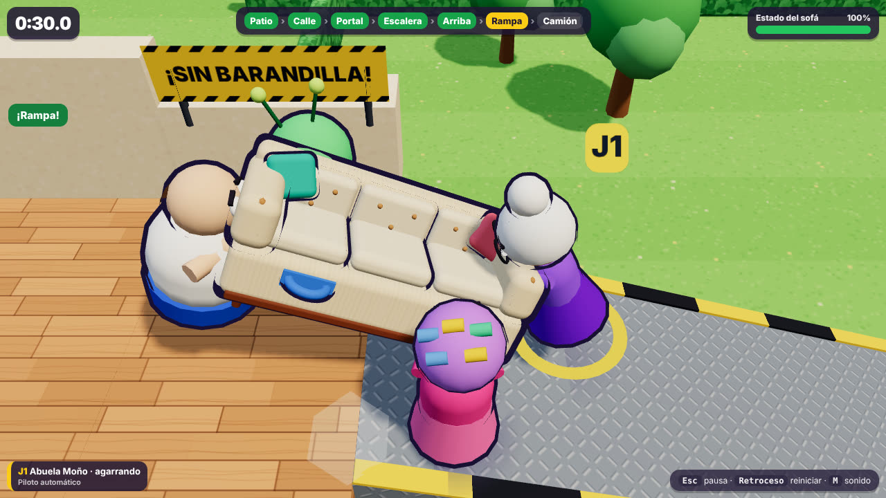
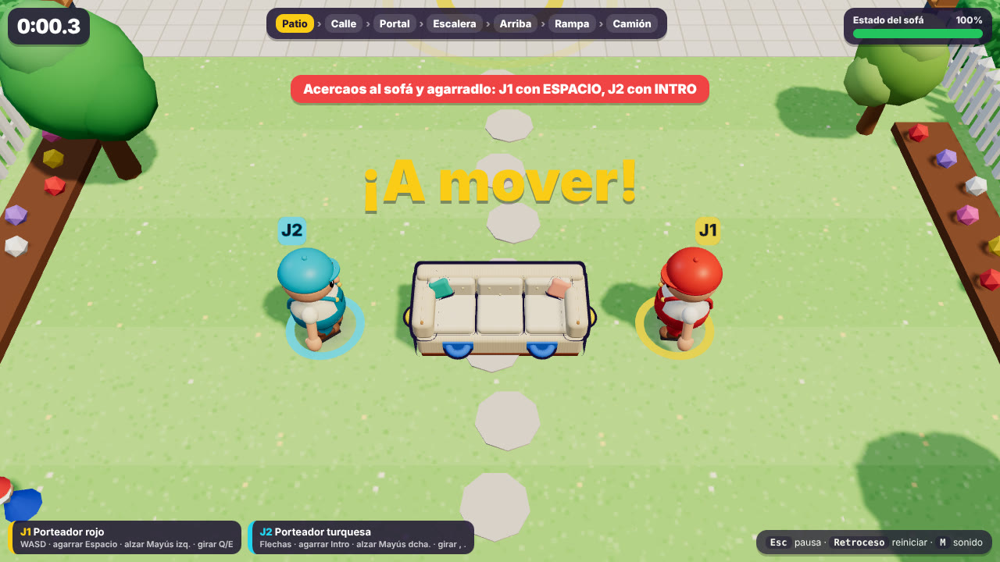

# La Mudanza Imposible · vertical slice físico

Demo jugable en el navegador **para dos personas en el mismo teclado**. Entre los dos hay que llevar un sofá desde una casa hasta un camión de mudanzas. Por el camino hay una calle con tráfico, una puerta estrecha, una escalera con giro de 90° y una rampa de chapa sin barandilla. El sofá pesa: uno solo lo arrastra por un extremo a menos de la mitad de velocidad y no puede subirlo por la escalera. Si uno suelta mientras tira, se tambalea y puede acabar en el suelo.

Todo lo que ocurre sale de la simulación física (Rapier). No hay animaciones prefabricadas que muevan el sofá.



Todas las capturas de `docs/capturas/` son reales: Chromium sin interfaz con render por software. Las de `docs/capturas/pulido/` comparan la misma partida antes y después del pase visual (ver [Pase visual](#pase-visual-y-de-animación)).

**Vídeo de una partida a dos (59 s, con los muñecos del laboratorio):** [`docs/video/mudanza-imposible-dos-jugadores.mp4`](docs/video/mudanza-imposible-dos-jugadores.mp4). Ver [cómo se ha grabado](#vídeo-de-la-partida-a-dos).

Vídeo anterior, de 1 jugador con ayudantes (40 s): [`docs/video/mudanza-imposible-partida-real.mp4`](docs/video/mudanza-imposible-partida-real.mp4).

## Cómo jugar en 1 minuto (dos jugadores)

```bash
cd mudanza-imposible
npm ci               # instala las versiones exactas del package-lock
npm run dev          # abre http://localhost:5173
```

1. En el menú ya están elegidos **2 jugadores y 2 porteadores** (sin ayudantes). Pulsa **Intro** o «¡A mover!».
2. **J1** (muñeco de peto y gorra rojos, aro amarillo): **WASD** para moverse, **Espacio** para agarrar o soltar y **Mayús izquierda** para alzar.
3. **J2** (muñeco de peto y gorra turquesa, aro azul claro): **flechas** para moverse, **Intro** para agarrar o soltar y **Mayús derecha** para alzar.
4. Cada uno se pone en un extremo del sofá, lo agarran y lo llevan hacia arriba de la pantalla. El aro amarillo en el suelo marca el siguiente objetivo. **En la escalera hay que alzarlo** (mantener Mayús); la pantalla lo recuerda al llegar.
5. **Objetivo:** dejar el sofá en la zona verde junto al camión en menos de 3 minutos sin destrozarlo. **Retroceso** reinicia en cualquier momento; en la pantalla final, **Intro** vuelve a empezar.

Para ver una partida completa sin tocar nada, usa «Ver demo automática» o abre `http://localhost:5173/?auto=1` (1 jugador con ayudantes).

Requisitos: Node 20 o superior y un navegador con WebGL (Chrome, Edge o Firefox). No hay servicios externos ni de pago.

Versión de producción: `npm run build` y después `npm run preview`, que sirve en `http://localhost:4173`.

## Partida a dos: física cooperativa

Cuando todos los porteadores son humanos (por defecto, 2 de 2), se activa la física cooperativa (`isCoop` en `src/sim/game.ts`):

| Qué | Cómo funciona |
|---|---|
| **El sofá pesa** | 90 kg nominales (45 con ayudantes) y más roce a rastras. Cada porteador mueve el mueble con una fuerza limitada (200 N, `CARRIER.pullForce`), y en pendiente sostiene además su propio peso. Uno solo lo arrastra por un extremo, mucho más despacio: 2,7 m en 3 s desde parado, frente a 6,9 m entre los dos (que lo llevan alzado a unos 2–3,4 m/s; tarda en arrancar y frenar). Solo no puede subirlo por la escalera ni moverlo empujándolo con el cuerpo. *Corrección:* la versión anterior de este README decía que uno solo «apenas lo arrastra (0–0,15 m en 1,5 s)». Esa cifra venía de casos del navegador en los que el sofá giraba en vez de avanzar. Si uno intenta llevarlo solo, la pantalla avisa: «¡Uno solo apenas puede con él! Agarradlo los dos». |
| **Tirar a la contra** | Si cada uno tira hacia un lado, el sofá gira sobre sí mismo (física, sin animación). |
| **Equilibrio** | Modelo del laboratorio de personaje (`../mudanza-imposible-character-lab/`), simplificado: un péndulo invertido que empujan las fuerzas que mide la física. Soltar mientras se tira con fuerza (la tensión desaparece de golpe) o que el compañero o el sofá te arrollen a la carrera te hace **tambalearte** («¡Uy, uy, uy!»: pasos apresurados hacia donde te caes, brazos en molinillo). Si no lo recuperas, **caes** («¡PATAPLOF!») hacia ese lado, sueltas el sofá y te levantas a los 1,3 s. Llevar el sofá con normalidad, agarrarlo (también llegando a la carrera: hay medio segundo para hacerse con el peso), alzarlo o chocar con una pared no tumba a nadie. |
| **Recuperarse** | Nadie se queda bloqueado: el que cae se levanta solo, el sofá volcado se endereza con R (J1) o - (J2), y si el sofá cae fuera del mapa vuelve al último punto. |

Con ayudantes de la máquina se mantiene la física original (sofá ligero, fuerza sin límite y sin pérdidas de equilibrio). Los ayudantes y el piloto automático están ajustados a ella; con la física cooperativa los ayudantes sueltan y reagarran para desatascarse y se caían una y otra vez.

**Por qué esta ruta.** El juego ya tenía partida completa, dos jugadores en un teclado, cronómetro, victoria, reinicio, sonido y pruebas; faltaba que hiciera falta cooperar y que hubiera tropiezos y caídas. Del laboratorio se trajo primero el modelo de equilibrio (la física) y después el muñeco (ver [Personajes](#personajes-el-muñeco-del-laboratorio)). La caída reutiliza el estado «tumbado» del juego, ya estable, en lugar de volcar la cápsula física como en el laboratorio.

## Personajes: el muñeco del laboratorio

Los jugadores humanos usan el muñeco desarrollado en `../mudanza-imposible-character-lab/` (iteración 2), como diseño provisional. Los ayudantes de la máquina conservan el reparto anterior (abuelas, gordo, alien…).



**Qué se ha comparado y qué se reutiliza:**

| Parte del laboratorio | ¿Se reutiliza? | Cómo |
|---|---|---|
| Modelo visual: proporciones, cabeza y cara, gorra, camiseta y peto, manoplas, botas | Sí, tal cual | `src/view/doll/dollRig.ts` es una copia adaptada de `characterRig.ts`: los colores entran como parámetro (`Look`) |
| Animación: planificador de pasos, apoyo de los pies en el suelo, rodillas, brazos al agarrar y en molinillo, cara (esfuerzo, susto) y miembros sueltos al caer | Sí | La misma; solo cambia de dónde lee los datos |
| Física del personaje del laboratorio (cápsula que se vuelca, control propio, agarre) | **No** | Habría sustituido la física cooperativa que ya funciona. El muñeco del laboratorio solo lee datos; no mueve nada físico |
| Equilibrio, caer y levantarse | Ya estaba (simplificado) en `carrier.ts` | El muñeco lo dibuja con sus propios gestos |

**Adaptador** (`src/view/doll/dollView.ts`). Traduce el porteador del juego a lo que lee el muñeco (`DollSource`): estado, velocidad, orientación, desequilibrio, agarre y esfuerzo (sale de la tensión del agarre). Dos diferencias con el laboratorio:
- **Caída.** En el juego, la cápsula sigue de pie mientras el porteador está en el suelo. El giro del cuerpo tumbado (hacia donde perdió el equilibrio, o hacia donde le lanzó un coche) y el levantarse se sintetizan aquí, girando alrededor de los pies y sin bajar del suelo.
- **Altura del suelo.** El laboratorio la tenía como función; aquí es un rayo de Rapier solo contra la geometría fija (ni el sofá ni otros porteadores).

**Identificación.** J1 conserva los colores originales (peto y gorra rojos). J2 lleva peto y gorra turquesa y pelo oscuro; J3 y J4 tienen variantes rosa y verde. Además, cada uno tiene su aro y su etiqueta de color, y su nombre en la interfaz («Porteador rojo», «Porteador turquesa»).

**Comprobado en el navegador** (`scripts/doll-check.cjs`, modo captura, misma física y dibujo):
- Vistas de frente, tres cuartos, lado y espalda de los dos ([J1 y J2](docs/capturas/personaje/vistas.jpg)).
- **Pies.** Ninguna esquina de suela por debajo del suelo en todo el recorrido (patio, calle, portal, escalera, piso de arriba, rampa y camión): 0 cm.
- **Sofá.** Agarre y transporte, también en la escalera y la rampa ([capturas](docs/capturas/personaje/escalera-rampa.jpg)).
- **Caída y levantarse.** Tambaleo con brazos en molinillo, cuerpo en el suelo con polvo y estrellas, y se levanta ([secuencia](docs/capturas/personaje/caida.jpg)).
- **Pruebas.** Todas las pruebas automáticas y de navegador siguen pasando (ver [Validación crítica](#validación-crítica-de-la-primera-demo)).

**Límites del muñeco en el juego:**
- **La cara se ve poco con la cámara del juego.** La cámara es alta y desde el sur, y al llevar el sofá hacia el norte se les ve sobre todo de espaldas y desde arriba: se les reconoce por la gorra, el color del peto, el aro y la etiqueta. Solo giran la cabeza hacia la cámara (hasta 1 rad) cuando hacen mucha fuerza o se tambalean.
- **El muñeco es unos 4 cm más ancho que su cápsula.** En primer plano, el tronco puede rozar o entrar un poco en el sofá al cargarlo.
- **Tumbado puede atravesar una pared** si cae junto a ella. La cápsula física sigue de pie: el cuerpo tumbado es dibujo y solo evita el suelo.
- **No lleva contorno de dibujo animado** como el resto del juego. Es un diseño provisional.
- **Coste de dibujo.** Con los materiales físicos del laboratorio (capa transparente y brillo de tela), dos muñecos dejaban el render por software de este contenedor en 3,7 fotogramas por segundo. Las pruebas en tiempo real empezaron a fallar porque algunas pulsaciones cortas caían entre dos fotogramas.
  - En el juego, el muñeco usa materiales estándar, como el resto de la escena, y solo sus piezas grandes proyectan sombra.
  - Con la misma medida: 6,8 fotogramas por segundo, frente a 7,7 antes de la integración (−12 %).
  - Llamadas de dibujo: de 166 a 208. Triángulos: de 45 000 a 62 000.
  - Con una tarjeta gráfica real no se ha medido.

## Validación crítica de la primera demo

Hecha el 19-10-2026 sobre la partida a dos. Punto de partida: rama limpia, 26 de 26 pruebas y tipos correctos.

**Método.**
- Revisión del código.
- Sondas de física en Node, con la misma simulación del juego.
- Pruebas en Chromium con pulsaciones de teclado enviadas por script.
- Capturas del juego en marcha.

**Nadie ha jugado todavía.** Cada hallazgo indica si está **demostrado** (una prueba o una medida lo reproduce), **observado** (se ve en capturas) o si es una **hipótesis** que necesita personas.

| Aspecto | Resultado | Tipo |
|---|---|---|
| Controles sin leer documentación | El menú trae la tabla de controles. Durante la partida, cada jugador tiene sus teclas en el panel inferior y, mientras nadie agarra, un aviso dice «J1 con ESPACIO, J2 con INTRO». Pero **alzar (Mayús) no se explicaba cuando hace falta**: es el problema 2. | Observado y demostrado |
| Agarrar y soltar | Fiable: 72 de 72 intentos desde 24 direcciones y 3 distancias, mirando al sofá. | Demostrado |
| Coordinarse y girar | Tirar a la contra gira el sofá 0,5–1,6 rad (prueba de navegador). Q/E hace que quien lo pulsa rodee el sofá. | Demostrado / hipótesis: si se entiende |
| Reacción a tirones opuestos | Legible: tirar cada uno hacia su lado gira el sofá. Si uno suelta en plena tensión, se cae (2 de 3). Soltar en situaciones normales no tumba a nadie (0 tambaleos en 12 casos). | Demostrado |
| Caídas | No son aleatorias: solo hay dos causas, soltar en plena tensión y que te arrollen a la carrera. Siempre te levantas solo, en 1,3 s. | Demostrado / hipótesis: si hacen gracia |
| Cámara | **Los árboles del patio tapaban a los jugadores**, porque se puede pasar por debajo: es el problema 3. Las paredes ya se recortaban. **Las caras se ven poco** (ver [Personajes](#personajes-el-muñeco-del-laboratorio)). | Observado |
| Recorrido y escalera | Con el piloto llevando a los dos, la escalera se lleva 13,6 s de 46. Pero subir el tramo son unos 2,6 s: el resto es el piloto retrocediendo para desatascarse, no el juego. **Sin alzar, la escalera no se puede subir**: es el problema 2. El cruce de la calle dura unos 4 s y el verde para peatones, 6 s. | Demostrado / hipótesis: si la escalera y el semáforo resultan interesantes o solo lentos |
| Interfaz | Muestra tiempo, etapas y estado del sofá, los avisos, el estado de cada jugador («agarrando», «¡tambaleándose!», «¡al suelo!») y la victoria con estrellas. Los nombres de los jugadores ya no correspondían al muñeco; se corrigieron al integrarlo. | Observado |
| Bloqueos y estrategias triviales | **Uno solo empujando con el cuerpo, sin agarrar, llevaba el sofá 14 m en 3 s**, más rápido que dos cargándolo: es el problema 1. Sin alzar, la escalera bloquea la partida (problema 2). | Demostrado |
| Vibración | Con el sofá agarrado y quieto, deriva 2,4 cm en 3 s y gira como máximo 0,28 rad/s. Es leve y no se corrige. | Demostrado |

### Los tres problemas prioritarios y su corrección

1. **Se podía ganar sin cooperar, empujando el sofá con el cuerpo.**
   - **Por qué importa:** rompía la premisa del juego. El límite de fuerza solo valía al agarrar, así que uno solo empujando lo llevaba 14,1 m en 3 s y dos cargándolo, unos 5 m.
   - **Corrección:** con la física cooperativa, quien toca el sofá con el cuerpo empuja con la misma fuerza limitada que al tirar (`Carrier.touching`).
   - **Resultado:** el choque inicial lo mueve 1,3 m y después, nada (0 m en 9 s). Una prueba de regresión lo comprueba; sin la corrección falla (9,8 m).
2. **La escalera bloqueaba la partida a quien no alzaba, y el aviso aconsejaba lo contrario.**
   - **Por qué importa:** sin mantener Mayús, la pareja no pasaba de la escalera en 180 s, y el aviso de atasco decía «gira el sofá». Era la única forma de quedarse atascado sin salida aparente.
   - **Corrección:** no se ha tocado la física. Al llegar al pie de la escalera con el sofá sin alzar, la pantalla dice «Escalera: alzad el sofá para subir. Mantened Mayús (J1 la izquierda, J2 la derecha)», con prioridad sobre el aviso de atasco.
   - **Resultado:** una prueba de regresión comprueba que sin alzar se atascan y aparece el aviso, y que al alzar suben.
3. **Los árboles del patio escondían a los jugadores.**
   - **Por qué importa:** el patio es donde se empieza, se aprende y se cae. Los árboles no tienen colisión y su copa ocultaba al personaje entero.
   - **Corrección:** las copas de los 7 árboles junto al recorrido se ocultan mientras tapan a un jugador o al sofá, como ya se hacía con ventanas, toldos y dinteles.
   - **Resultado:** [antes y después](docs/capturas/validacion/arbol-antes-despues.jpg).

### Encontrado y no corregido (por orden de impacto)

- **Las caras se ven poco con la cámara del juego.** Al llevar el sofá se les ve de espaldas y desde arriba.
- **El semáforo deja poco margen.** El cruce dura unos 4 s de los 6 s de verde. Si una pareja duda, la arrollan, y los atropellos repetidos pueden destrozar el sofá. Hace falta verlo con personas.
- **La espera al semáforo** (hasta 17 s) es tiempo muerto para los dos.
- **Leve deriva del sofá** agarrado y quieto.
- **Q/E** hace que quien lo pulsa rodee el sofá. Falta comprobar con personas si se entiende o si basta con tirar a la contra.
- **Las pruebas con dos pilotos automáticos** a veces se bloquean entre sí: cada piloto retrocede por su cuenta. Es una limitación de las pruebas, no del juego.

## Controles

| Acción | J1 (teclado) | J2 (teclado) | Mando (J1–J4) |
|---|---|---|---|
| Moverse | W A S D | Flechas | Stick izquierdo o cruceta |
| Agarrar / soltar | Espacio | Intro | A |
| Alzar (mantener) | Mayús izq. | Mayús dcha. | B o gatillos |
| Girar el sofá (rodeándolo; también tus ayudantes) | Q / E | , / . | LB / RB |
| Enderezar el sofá volcado | R | - | Y |
| Pausa | Esc | | Start |
| Reiniciar | Retroceso | | Start (en resultados) |
| Silenciar | M | | |

**Objetivo:** dejar el sofá en la zona amarilla junto al camión en menos de 3 minutos, sin que su estado llegue a 0 %.

**Estrellas:**
- una por entregar;
- otra si tardas 90 s o menos;
- otra si el sofá llega con un 70 % o más.

**Qué daña el sofá:**

| Causa | Daño |
|---|---|
| Golpe o caída brusca | Proporcional a la violencia |
| Atropello | −12 % |
| Enderezarlo | −3 % |
| Caer fuera del mapa | −15 %, +5 s y reaparece en el último punto |

## El recorrido

| Etapa | Qué pone a prueba |
|---|---|
| Patio | Agarrar y coordinarse. El sofá sale atravesado: hay que girarlo. |
| Calle | Dos carriles con coches y un semáforo cuyo ciclo es: verde para coches 8 s, ámbar 1,6 s, rojo total 1,4 s, verde para peatones 6 s. Si algo se queda en la calzada, los coches pitan, frenan a 3,2 m/s y lo empujan. |
| Portal | Puerta de 1,6 m. El sofá mide 2,2 × 0,9 m: solo pasa de largo, y los porteadores de los lados chocan con el marco. |
| Escalera | Rampa de 20° con peldaños visuales. Arriba, un rellano obliga a girar 90°. |
| Pasillo de arriba y terraza | Las paredes que tapan la acción se recortan hasta un zócalo, como en una maqueta. |
| Rampa | Chapa resbaladiza, 17° y sin barandilla. Si soltáis el sofá, baja deslizándose; si se cae por un lado, recibe daño (y a veces ahorra camino). |
| Entrega | El sofá tiene que reposar dentro de la zona 1 s. |

## Decisiones técnicas

- **Stack:** Vite 7, TypeScript, Three.js 0.179 y Rapier 0.19 (`rapier3d-compat`, WASM).
  - El repositorio solo tenía el motor por turnos de «A la de tres», que no sirve para física en tiempo real. Lo he dejado intacto en `../a-la-de-tres/` y he creado esta demo aislada.
  - Rapier es determinista, rápido (unos 0,1–0,16 ms por paso con 2–6 porteadores) y funciona igual en Node que en el navegador, así que la física se puede probar sin interfaz.
- **Simulación separada del dibujo:** `src/sim/` no importa Three.js ni el DOM. El bucle del navegador avanza la física a paso fijo (60 Hz) y luego dibuja.
- **Agarre:** articulación de rótula entre la mano del porteador y el punto del sofá que agarra.
  - Por eso el sofá gira, se inclina o se atasca según desde dónde y hacia dónde tira cada uno.
  - La mano empieza en el punto agarrado y sube a su altura a 1,4 m/s, para evitar tirones.
  - Si la mano y el punto se separan más de 0,55 m (dos personas tirando en sentidos opuestos, un golpe), el agarre se suelta («¡Se escapa!»).
- **Muñecas:** una rótula no hace par, así que con dos personas por los extremos el sofá giraba sobre su eje largo sin parar. He añadido un par estabilizador proporcional al número de manos. Deja inclinarlo, pero no voltearlo con facilidad. Es una ayuda física deliberada y está documentada en `game.ts` (`wristAssist`).
- **Porteadores:** cápsulas dinámicas con rotación bloqueada, controladas por velocidad objetivo con una aceleración máxima. Así responden al instante, pero pueden ser arrastrados por el sofá o por otros.
- **Recuperación sin reiniciar:**
  - **R** endereza el sofá.
  - Si cae fuera del mapa, reaparece en el último punto.
  - Un porteador que se queda lejos vuelve junto al sofá.
  - Se limitan las velocidades extremas del sofá para que un conflicto del solver no lo lance por los aires.
- **Ayudantes de la máquina** (`bots.ts`): son deliberadamente simples.
  - Van a un asa libre e imitan, con 0,17 s de retraso, cómo se mueven los humanos que cargan.
  - Acompañan los giros que se piden con Q/E.
  - Si empujan contra algo sin avanzar, sueltan el asa y vuelven a agarrar al poco. Así pasan la puerta.
  - En modo «Despistados» reaccionan más tarde y se desvían.
- **Piloto automático** (`autopilot.ts`): conoce la ruta y lleva al jugador 1. Sirve para el modo demo y para comprobar con la física real que el nivel se puede completar. No es una IA de juego.
- **Cámara:** cenital oblicua (unos 53°) con el norte siempre arriba, centrada en el sofá con un poco de adelanto y de peso hacia los humanos.
  - Se aleja si el grupo se dispersa.
  - Las paredes que tapan la acción se recortan hasta un zócalo opaco (corte de maqueta). Ventanas, toldos y el dintel de la puerta se ocultan; las jambas quedan a la vista para que se lea lo estrecha que es la puerta.
  - No gira, para que las direcciones de los controles no cambien y quien mira una grabación entienda el recorrido como en un mapa.
- **Aspecto:** todo es geometría procedural y texturas dibujadas en canvas al arrancar (sin modelos, imágenes ni texturas de terceros), con un estilo de juguete coherente con el concepto visual previo: abuelas, enano, gordo, alien y perro salchicha, y sofá crema con asas rojas y azules. Detalle en [Pase visual](#pase-visual-y-de-animación).
- **Sonido:** sintetizado con WebAudio, sin archivos.

## Estructura

```
mudanza-imposible/
  index.html            menú, interfaz, pausa y resultados (DOM + CSS)
  src/main.ts           bucle de juego, menú, eventos → sonido/efectos/mensajes
  src/sim/              simulación (sin Three.js)
    level.ts            geometría del recorrido, etapas y puntos de paso
    sofa.ts             cuerpo del sofá, asas y utilidades de rotación
    carrier.ts          porteador: movimiento, agarre, alzar, soltar y equilibrio
    traffic.ts          coches, carriles y semáforo
    bots.ts             ayudantes de la máquina
    autopilot.ts        piloto automático (demo y pruebas)
    game.ts             estado de la partida, daños, recuperación, victoria/derrota
  src/view/             dibujo con Three.js (escena, sofá, personajes, coches, efectos, cámara)
    textures.ts         texturas procedurales (asfalto, baldosa, ladrillo, tablas, tejas, chapa, tela, fachadas)
  src/input/input.ts    teclado (2 jugadores) y mandos (hasta 4)
  src/audio/sfx.ts      sonidos sintetizados
  src/ui/hud.ts         interfaz durante la partida
  tests/sim.test.ts     pruebas de la física sin navegador (Vitest)
  scripts/              simulación por consola, rendimiento, pruebas en Chromium, capturas y vídeo
    stills.cjs          capturas fijas en momentos fijos de una partida automática (?capture=1)
    record.cjs          graba la partida real fotograma a fotograma con su sonido
    video-cards.cjs     rótulos del vídeo
    make-video.sh       monta el MP4 (ffmpeg)
    duo-e2e.cjs         partida a dos en Chromium de principio a fin (npm run e2e:duo)
    record-duo.cjs      graba la partida a dos fotograma a fotograma con su sonido
    make-video-duo.sh   monta el MP4 de la partida a dos
  docs/capturas/        capturas reales (pulido/: antes y después del pase visual)
  docs/video/           vídeo de una partida real
```

## Pruebas ejecutadas y resultados reales

Todas se ejecutaron en este entorno (contenedor Linux sin GPU) entre el 18 y el 19-10-2026. La última vez fue tras integrar el muñeco y las tres correcciones de la validación crítica.

### 1. `npm test`: 28 de 28 pruebas pasan

(19-10-2026; las anteriores siguen pasando sin cambiar ningún umbral)

| Grupo | Qué comprueban |
|---|---|
| Regresiones de la validación crítica (2) | Empujar el sofá con el cuerpo, sin agarrarlo, no lo mueve después del choque inicial (sin la corrección: 9,8 m). Sin alzar, la pareja se atasca al pie de la escalera y aparece el aviso; alzando, sube. |
| Dos jugadores sin ayudantes (física cooperativa, 8 pruebas) | La física cooperativa solo se activa sin ayudantes. Uno solo lleva el sofá menos de 3,2 m en 3 s y los dos, más del doble. Tirar a la contra lo gira (>0,5 rad) sin velocidades absurdas. Soltar mientras se tira con fuerza: tambaleo y caída, y a los 1,3 s se levanta. Llevarlo juntos (andar y alzar) no desequilibra a nadie, ni agarrarlo llegando a la carrera (esta prueba falla si se quita el margen tras agarrar). Chocar a la carrera con el compañero desequilibra a los dos, y contra una pared no. Dos jugadores llevados por el piloto automático completan el recorrido, todas las etapas en orden. |
| Sofá y agarre | En reposo no se mueve ni vibra (<2 cm en 3 s). Los ayudantes agarran y, con el jugador, levantan el sofá (>0,6 m) y lo sacan del patio. Agarrar y soltar funcionan. |
| Puerta estrecha | De lado se queda en la fachada; de largo pasa. |
| Tráfico | El semáforo da paso a los peatones solo después del ámbar y del rojo total. Un coche pita, golpea, daña (−12 %) y desplaza el sofá que está en su carril. Un porteador atropellado queda mareado. |
| Recuperación | Enderezar. Reaparecer al caer fuera del mapa (−15 %). Un porteador perdido vuelve junto al sofá. |
| Partida completa | Con el piloto automático se entrega el sofá con 2 porteadores atentos, 4 atentos y 4 despistados, pasando por todas las etapas en orden. Se pierde al agotar el tiempo. |
| Rampa | Un sofá soltado en la chapa resbala más de 2,5 m. |
| Datos del nivel | Todas las cajas tienen dimensiones válidas. |

### 2. `npm run sim`: piloto automático con física real, configuraciones variadas

| Porteadores | Ayudantes | Resultado | Tiempo | Estado del sofá |
|---|---|---|---|---|
| 2 | atentos | entregado | 35,6 s | 100 % |
| 3 | atentos | entregado | 36,0 s | 100 % |
| 4 | atentos | entregado | 36,0 s | 100 % |
| 4 | despistados | entregado | 46,5 s | 97 % |
| 4 | despistados | entregado | 62,6 s | 99 % |
| 5 | atentos | entregado | 102,4 s | 100 % |
| 6 | despistados | entregado | 77,7 s | 81 % |
| 6 | atentos (semilla 1) | **tiempo agotado** | 180 s | — |

El último caso es la última medición de una configuración que, en ejecuciones anteriores de la sesión, a veces sí se completaba. Con 6 porteadores el grupo es muy ancho y el piloto automático se atasca girando en el rellano.

### 3. Pruebas en Chromium (Playwright, render por software)

Repetidas el 19-10-2026 con los muñecos y las tres correcciones. `e2e:smoke`, `e2e:teclado` y `e2e:dos` pasan. **`e2e:duo` pasa entera en 2 de las 3 ejecuciones finales; en la tercera falla una comprobación** (ver abajo). Las tres primeras fijan en la URL su escenario de 1 jugador con ayudantes, porque el menú propone por defecto 2 jugadores.

| Prueba | Resultado |
|---|---|
| `e2e:duo` (partida a dos de principio a fin; 20 comprobaciones) | **Ejecuciones finales: 20/20, 20/20 y 19/20.** <br>La que falla es «soltar mientras tira: J2 se tambalea y cae»: J2 se tambaleó, pero no llegó a caer. No es una regresión: en Node, el código anterior y el actual dan lo mismo caso a caso (37 caídas y 42 tambaleos en 42 tirones). Con poca tensión al soltar solo hay tambaleo, y en el navegador la tensión depende de cuánto haya girado antes el sofá. La comprobación se deja como está: exige caída. <br>Con teclas reales: <br>• El menú propone 2 jugadores sin ayudantes e Intro empieza la partida. <br>• Los dos se mueven a la vez (W y flecha abajo: ±1,8–2,0 m). <br>• Agarran a la vez con Espacio e Intro. <br>• En 2,5 s juntos llevan el sofá 5,6–6,6 m, y uno solo 0,01–1,56 m, con el aviso en pantalla. <br>• Tirando de través cada uno hacia un lado, el sofá gira 0,6–1,2 rad. <br>• Si J2 suelta mientras tira, se tambalea y en general cae; se levanta solo y vuelve a agarrar. <br>• Corriendo contra la valla o el límite de la acera, J1 se para sin caerse. <br>• Retroceso reinicia. <br>Con el piloto automático llevando a los dos (modo captura, misma física y dibujo): <br>• Victoria en 46,4 s con el sofá al 100 %, sin valores no numéricos ni velocidades disparadas. <br>• Pantalla de resultados «¡Sofá entregado!»; Intro (tecla real) empieza otra partida desde cero. <br>• Sin errores de página ni de consola. <br>Capturas en [`docs/capturas/duo/`](docs/capturas/duo/). |
| `e2e:smoke` (demo automática con 4 porteadores) | La partida se completa en 36,0 s con el sofá al 100 %. Sin errores de página. Queda un aviso benigno de la propia Rapier («deprecated parameters»). Unas 280 llamadas de dibujo y 48 000 triángulos por fotograma (antes del pase visual: 114 y 18 000). |
| `e2e:teclado` (teclas reales) | Agarrar con Espacio, que los ayudantes agarren, llevar el sofá con W (3,5 m), levantarlo (0,83 m), girarlo con Q (0,59–0,75 rad), alzarlo con Mayús (+0,56 m), soltarlo, pausar con Esc y reiniciar con Retroceso. Todo OK en las 3 últimas ejecuciones. Ver la nota sobre la resolución adaptable en [Rendimiento](#rendimiento). |
| `e2e:dos` (dos jugadores en el mismo teclado, sin ayudantes) | Los dos agarran, avanzan juntos y, si tiran en direcciones opuestas, el sofá gira por pura física. Con la física cooperativa, medida en tiempo de juego: 3,56 m y 1,55 rad. Antes, con esperas de reloj a pocos fotogramas por segundo, salían 1,61 m y 0,83 rad, porque avanzaba menos tiempo de juego. Con el sofá ligero: 3,5–3,6 m y 1,4–1,5 rad. |

**Fallos intermitentes de `e2e:duo` y su causa.**

- **Primeras versiones.** El giro salía corto y el aviso de «uno solo» a veces no aparecía. Eran fallos de la propia prueba: a veces tiraba a lo largo del eje del sofá y esperaba demasiado poco. Esa investigación sí destapó un fallo real del juego: agarrar el sofá llegando a la carrera hacía tambalearse. Se corrigió con medio segundo para hacerse con el peso, y hay una prueba de Vitest que falla sin esa corrección.
- **Durante la validación crítica (19-10-2026)** aparecieron cuatro fallos más. Todos eran de la prueba, no del juego:
  1. **Pulsaciones perdidas.** Con los muñecos, el render por software va a unos 6,8 fotogramas por segundo, así que un fotograma dura más de 100 ms y una pulsación de 90 ms de reloj podía no llegar a verse. Ahora las esperas se miden en tiempo de juego, también en `e2e:dos`.
  2. **Ventanas distintas.** «Juntos» se medía 1,5 s, aún acelerando, y «solo», 2,5 s. Ahora se miden los dos 2,5 s, con el mismo umbral que antes: solo, menos de la mitad que juntos.
  3. **El piloto de prueba no llegaba a su extremo del sofá.** En 1 de 3 ejecuciones, J2 pasó 12 s sin llegar a agarrar, y los pasos siguientes fallaron en cascada.
     - El piloto de prueba se mueve con las teclas por ejes, en línea recta, y cada pulsación dura al menos un fotograma (unos 0,15 s a 7 fps, es decir, 0,6–0,75 m). Según la anotación de la ejecución siguiente, unas veces el sofá le cortaba el paso y otras daba vueltas alrededor del objetivo sin acertar a quedar a menos de 0,2 m. Antes de la corrección 1 podía apartar el sofá a empujones; ahora ya no.
     - Se descartó que fuera del juego. En Node, andar es normal (5,2 m/s tras darse la vuelta) y rodear el sofá rozándolo funciona: se llega al extremo en 0,35–0,6 s en 8 casos, con o sin el compañero agarrando.
     - Ahora el piloto de prueba rodea el sofá si no se acerca en unos 0,8 s, y cada rodeo queda anotado en la salida: hubo 9 en la primera ejecución final.
  4. **La comprobación de la pared no comprobaba nada.** Al alargar el tramo «juntos», el sofá salía del patio y J1 corría por la acera sin chocar con nada (x = 14,24). En otra ejecución, tras el fallo anterior, ni se movía (x = −1,46). Las dos contaban como OK.
     - Ahora J1 corre hasta que algo le para. Solo cuenta si se para en la valla, el seto o el límite de la acera, sin estar agarrado y sin caerse.
     - Antes de correr espera a que se le pase el tambaleo de soltar el sofá en tensión, que es parte de la mecánica.
- **Soltar y volver a agarrar.** También se investigó si hacerlo rápido tumbaba. Era el piloto de prueba pulsando agarrar en 6 pasos de física seguidos, algo que una persona no puede hacer: el juego solo cuenta la pulsación nueva. Se descartaron el cambio y su prueba.

Para ejecutarlas hace falta Playwright con Chromium, que no está en las dependencias. Con la demo servida en el puerto 4173:

```bash
NODE_PATH=$(npm root -g) npm run e2e:teclado
```

### Rendimiento

| Medida | Valor |
|---|---|
| Física (`npm run perf`) | 0,11 ms por paso con 2–4 porteadores y 0,16 ms con 6 (el presupuesto es de 16,7 ms) |
| Carga (Chromium local) | Aproximadamente 1 MB transferido (gzip). Menú listo en 1,9–2,8 s, con render por software |
| Imagen en este contenedor (render por software, sin GPU) | Unos 6 fotogramas reales por segundo con 4 porteadores a 1280×720, con la resolución adaptable al mínimo (la mitad). Antes del pase visual eran unos 4–5 a resolución completa |
| Coste por fotograma a resolución completa en este contenedor | 360 ms con sombras; 240 ms sin ellas; 180 ms sin personajes ni sofá; 54 ms a media resolución. Limita la cantidad de píxeles, no el número de objetos |

**No he podido medir los fps con una tarjeta gráfica real.** Unas 280 llamadas de dibujo y 48 000 triángulos deberían ir fluidos en un ordenador normal, pero queda por comprobar.

- **Ojo con la cifra `fps` de `__mudanza.fps()`:** el bucle limita cada fotograma a 0,1 s, así que en este contenedor marca unos 11 aunque los fotogramas reales sean menos. Para medir, cuenta fotogramas (`renderInfo().frame`) en un intervalo de tiempo real.
- **Resolución adaptable** (`WorldView.adapt`): si los fotogramas tardan más de 1/28 s, baja la densidad de píxeles por pasos hasta la mitad; si sobra margen, la sube. Es para móviles modestos y render por software.
  - Sin ella, el pase visual dejaba el contenedor en unos 3 fotogramas por segundo.
  - Con eso, `e2e:teclado` fallaba: mantiene las teclas un tiempo real fijo, y avanzaba menos tiempo de juego. La física no había cambiado.
- **Geometría estática fundida por material** (`mergeStatic` en `levelView.ts`): de 327 a unas 250 llamadas de dibujo. Personajes y sofá siguen siendo la mayor parte (unas 34 por personaje).

## Pase visual y de animación

La revisión se hizo sobre capturas reales del juego en ejecución, con encuadres y tiempos de partida iguales antes y después (`scripts/stills.cjs`).

Hubo dos ciclos:
1. Primer pase propio.
2. Tres revisiones independientes, todas de solo lectura: dirección de arte, arte técnico con estabilidad del juego, y QA visual con encargo de buscar defectos, no de aprobar. Después, un segundo pase con sus hallazgos.

No se han tocado las reglas físicas ni el recorrido.

**Dirección visual.**
- Juguete de plástico mate y fieltro, con contorno azul marino.
- Los personajes y el sofá llevan los colores más saturados; el suelo queda en valores medios.
- Rojo, azul y amarillo se reservan para el juego: asas, objetivo y peligro.
- Luz cálida de tarde con un relleno frío.

| Área | Antes | Ahora |
|---|---|---|
| Personajes | Cilindros sin piernas, brazos de palo y cara apenas visible | Silueta propia para cada uno: moño y gafas, rulos y bata, calvo tostado con bigote, cíclope con antenas, casco y barba, salchicha de cuatro patas. Piernas y zapatos, cara con ojos, cejas y boca, y contorno de dibujo animado |
| Animación | Balanceo al andar y estrellas | Ver la lista de abajo |
| Sofá | Crema liso, asas como bloques y patas | Tela con trama, ribete, zócalo de madera, capitoné, dos cojines de color, cinchas de mudanza como asas, cojines que se bambolean con la inercia y rebote al golpear (deformación limitada al volumen del colisionador) |
| Entorno | Cajas de colores planos | Texturas procedurales (asfalto, baldosa, ladrillo, tablas, tejas, chapa lagrimada), barrio de fondo con ventanas y persianas, toldos, farolas, bancos, papeleras, boca de incendios, valla de estacas, gnomo de jardín y camión abierto con cajas dentro |
| Objetivo | Diamante flotante que tapaba coches y escaleras | Aro en el suelo con una flecha pequeña; se apaga solo cuando el sofá está encima |
| Paredes que tapan | Translúcidas: un personaje detrás parecía transparente | Corte de maqueta hasta un zócalo opaco |
| Efectos | Polvo y estrellas | Polvo al pisar a la carrera y al aterrizar, ondas de choque, confeti al entregar, sudor al hacer fuerza; textos sobre placa de color («¡CATAPUM!», «¡ATASCO!», «¡ENTREGADO!») |
| Cámara | 52°, más lejos | 53° y más cerca: las cabezas tapan menos el sofá |

**Animación procedural ligada al estado real** (`carrierView.ts`, todo depende de datos de la simulación):
- Paso hacia delante o lateral según la velocidad real, respecto a hacia dónde mira.
- Pataleo en el sitio si quiere andar (`wantVel`) y no avanza.
- Inclinación según la dirección del tirón del agarre: hacia atrás si el sofá tira de él, hacia el sofá si empuja, de lado si el tirón es lateral.
- Temblor y sudor cuando el agarre está cerca de soltarse; además gira la cabeza hacia la cámara para que se le vea la cara de esfuerzo.
- Traspié solo con el suceso `gripBreak`, hacia atrás o hacia delante según hacia dónde tiraba.
- Atropello (`stunned`): pirueta en un solo sentido, caída de espaldas en la dirección del golpe, pataleo con estrellas y, al acabar el mareo, se levanta de un salto.
- Pose en el aire (`grounded` = falso) y aplastamiento con polvo al aterrizar.

### Revisión visual: defectos encontrados y estado

| Defecto (revisión independiente) | Estado |
|---|---|
| Un personaje detrás de la pared del pasillo de arriba parecía transparente | Corregido: corte de maqueta |
| Los ojos pasaban casi la mitad del tiempo cerrados (error en el parpadeo) | Corregido |
| La pirueta del atropello giraba hacia un lado y volvía | Corregido: un solo sentido y caída según el golpe |
| Inclinación siempre hacia atrás, también al empujar | Corregido |
| Casi nunca se veían caras | Mejorado: miran a cámara al hacer fuerza o tropezar |
| La cabeza calva de Gordo se confundía con el sofá crema | Corregido: piel tostada y cerco de pelo |
| Rueda negra asomando dentro de la caja del camión y rótulo del techo cortado | Corregido |
| Tejados demasiado llamativos alrededor de la escalera y peldaños poco legibles | Mejorado: tejas más apagadas y canto claro en cada peldaño |
| Farolas como trazos negros que cruzaban la imagen | Corregido: pintadas, con globo y sin las de la acera cercana |
| El aviso «pulsa ESPACIO» aparecía mientras el jugador estaba mareado | Corregido |
| Textos flotantes poco legibles o superpuestos («¡CATAPUM!» con «-1%») | Mejorado: placa de color, más altos y sin texto de daño tras un atropello |
| Patas del sofá hundidas en el suelo y deformación que sacaba el sofá 11 cm de su colisionador | Corregido |
| Fugas de memoria de vídeo en las estrellas y al reiniciar | Corregido |

Pendientes, por orden de impacto:
1. **En el plano general, el grupo sigue siendo pequeño en la pantalla de un móvil.** Con cuatro porteadores, las cabezas del lado de la cámara tapan parte del sofá.
2. **El atropello se entiende por el efecto, no por la causa.** El coche es cinemático: no frena ni rebota y atraviesa al grupo. Además, nada une el semáforo en rojo con el golpe. Arreglarlo bien toca el tráfico (física), así que se ha dejado.
3. **Los textos de teclado** («WASD», «ESPACIO») no tienen equivalente táctil, porque no hay controles táctiles.
4. **Personajes:** algunos se meten en el brazo del sofá al inclinarse mucho. Las manos no se cierran sobre el asa y no hay dedos.
5. **La puerta estrecha:** con la fachada recortada se lee el hueco, pero el apretón contra el marco no se percibe tanto como en un juego comercial.
6. **Rendimiento:** unas 34 llamadas de dibujo por personaje y sombras de todo el nivel en cada fotograma. Es aceptable para una demo, pero conviene fundir más mallas antes de llegar a 6–10 jugadores.

## Vídeo de gameplay actual (commit 3b50dfb)

[`docs/video/mudanza-imposible-gameplay-3b50dfb-2026-10-19.mp4`](docs/video/mudanza-imposible-gameplay-3b50dfb-2026-10-19.mp4): 59,9 s, 9,6 MB (9 578 464 bytes), 1280×720 a 30 fps, H.264 High con AAC. [Fotogramas de muestra](docs/capturas/video-gameplay-3b50dfb.jpg).

- **Qué se grabó.** El juego del commit `3b50dfb` (los muñecos del laboratorio y las tres correcciones de la validación crítica), compilado con `npm run build` y servido con `vite preview`. Se comprobó que el navegador cargaba ese paquete (`index-DGvHfqHP.js`) y que la partida tenía dos jugadores humanos y el código de la última corrección. Grabado el 19-10-2026 con el mecanismo de siempre (`record-duo.cjs` y `make-video-duo.sh`), sin tocar la física, los personajes ni el mapa.
- **Diferencias con el vídeo anterior del grabador.** El rótulo inicial indica la versión grabada, y se guardan los dos últimos segundos de la cuenta atrás para ver a los dos personajes antes de empezar.

**Contenido, por tiempos del vídeo:**

| Tramo | Qué se ve | Quién controla |
|---|---|---|
| 0–3 s | Rótulo con el título y la versión (imagen fija, no es juego) | — |
| 3–13 s | Cuenta atrás con los dos muñecos (J1 rojo, J2 turquesa). Agarran a la vez, tiran juntos, tiran a la contra (el sofá gira) y J2 suelta tirando: se tambalea y cae («¡PATAPLOF!») | Pulsaciones de teclado enviadas por un script de Playwright |
| 13–21 s | Salen del patio hasta la acera | Piloto automático del juego para J1 y J2 |
| 21–60 s | Se cortan 8,7 s de espera con el semáforo en rojo (lo indica un rótulo). Después: cruce, portal, escalera (con el aviso «alzad el sofá»), piso de arriba, rampa y camión. «¡Sofá entregado!» en 60,3 s de juego, con el sofá al 100 % y 3 estrellas | Piloto automático del juego |

**Limitaciones de la grabación:**

- **Ninguna persona jugó.** Las pulsaciones las envía un script y el resto lo lleva el piloto automático. Es la física real del juego, a velocidad real, pero no muestra cómo juega una persona.
- **No es tiempo real del reloj.** Se graba en modo captura: cada fotograma avanza 1/30 s de juego. El contenedor no tiene GPU y tardó 669 s en dibujar los 57 s de juego.
- **Solo se cortó una espera.** No hay más montaje que el corte del semáforo; no se ha acelerado nada.
- **Lo que se ve mal en el vídeo:**
  - **La caída de J2 se ve poco.** Ocurre en el borde inferior de la imagen y el rótulo «¡PATAPLOF!» la tapa en parte.
  - **J2 sale de cuadro.** Mientras J1 tira solo (hacia los 11 s), J2 queda fuera de la imagen: la cámara sigue sobre todo al sofá.
  - **Las caras apenas se ven** desde la cámara del juego.

## Vídeo de la partida a dos

[`docs/video/mudanza-imposible-dos-jugadores.mp4`](docs/video/mudanza-imposible-dos-jugadores.mp4): 59 s, 9,5 MB, 1280×720 a 30 fps, H.264 High 4.0 con AAC y `faststart`.

- **Cómo se graba.** La demo real en Chromium, en modo captura (`?capture=1`): cada fotograma avanza 1/30 s de juego y después se captura, así que va a velocidad real aunque el contenedor dibuje despacio. El sonido son los efectos del propio juego, renderizados fuera de línea.
- **Grabación.** Se grabó de nuevo el 19-10-2026 con los muñecos y las correcciones de la validación.
- **Tramo 1 (9 s).** J1 y J2 con el teclado del juego: agarran a la vez (Espacio e Intro), tiran juntos, tiran a la contra (el sofá gira), cada uno tira hacia su lado y J2 suelta sin dejar de tirar: «¡Uy, uy, uy!» y «¡PATAPLOF!». J1 sigue solo y lo mueve muy poco («¡Uno solo apenas puede con él!»). **Las pulsaciones las envía un script de Playwright, no dos personas**, pero entran por el mismo teclado que usaría un jugador.
- **Tramo 2.** El piloto automático del juego lleva a J1 y a J2 (sin ayudantes, con la física cooperativa) por la calle, el portal, la escalera y la rampa hasta el camión: entregado en 60,3 s, con el sofá al 100 % y 3 estrellas. Al llegar a la escalera se ve el aviso nuevo («Escalera: alzad el sofá…»). Se corta la espera en la acera con el semáforo en rojo (un rótulo lo indica). No se ha acelerado nada.
- **Reproducir:** con la demo servida en :4173, `NODE_PATH=$(npm root -g) node scripts/record-duo.cjs` y después `scripts/make-video-duo.sh`.
- **Una primera toma se descartó.** En ella el tramo de teclado empujaba el sofá hasta la calle con el semáforo en rojo. Los coches lo atropellaron varias veces y el piloto tardó un minuto en sacarlo: entregado en 102,6 s con el sofá al 10 %. Sirvió para comprobar que la partida no se bloquea, pero no como vídeo corto. En la toma buena, el tramo de teclado se queda en el patio.

## Vídeo de la partida real (1 jugador con ayudantes)

[`docs/video/mudanza-imposible-partida-real.mp4`](docs/video/mudanza-imposible-partida-real.mp4): 40 s, 7,7 MB, 1280×720 a 30 fps, H.264 High 4.0 con AAC y `faststart`. Se reproduce en Android.

- **Cómo se graba.** Es la demo real en Chromium, en modo captura (`?capture=1`): cada fotograma avanza exactamente 1/30 s de juego y después se captura. El contenedor no tiene GPU y dibuja despacio; así el vídeo va a velocidad real.
- **Qué no tiene.** Ni aceleración ni cámara lenta. Solo se cortan dos tiempos muertos: la espera en la acera hasta que el semáforo se pone verde y el pasillo de arriba.
- **Sonido.** Los efectos sintetizados del propio juego, registrados durante la partida y renderizados fuera de línea con WebAudio.
- **Toma 1.** J1 con teclado agarra el sofá y avanza con W sin esperar al semáforo: un coche se lleva al grupo por delante. Las pulsaciones las envía un script de Playwright, no una persona, pero entran por el mismo sistema de teclado que usa un jugador.
- **Toma 2.** El piloto automático del juego, de la casa al camión: recogida, cruce en verde, portal, escalera, rampa y entrega al 100 % en 36 s.
- **Reproducir:**
  ```bash
  node scripts/record.cjs                  # con la demo servida en :4173
  node scripts/video-cards.cjs
  scripts/make-video.sh
  ```
  Los dos primeros necesitan Playwright (`NODE_PATH=$(npm root -g)`); el tercero, ffmpeg.

**Publicación.** El vídeo está en una página privada de claude.ai creada desde esta sesión, solo para su propietario: https://claude.ai/artifact/Bo3j9ipvmdz9wpVPxfqtqC. También está en este repositorio, en `docs/video/`. No se ha publicado la demo web jugable: no tiene controles táctiles, así que en el móvil solo se puede ver el vídeo.

## Recursos externos

No se ha incorporado ningún recurso externo: modelos, texturas, sonidos, animaciones o imágenes generadas. Las texturas se dibujan en canvas al arrancar y el sonido se sintetiza.

Se revisaron dos archivos aportados:
- `open-source-games` (CC0) es una lista de enlaces a juegos.
- `Claude-Code-Game-Studios` (MIT) son definiciones de agentes.

Ninguno contiene recursos 3D utilizables. Del segundo solo se tomó como referencia el reparto de papeles para las revisiones (dirección de arte, arte técnico, QA); no se ha instalado.

## Qué está hecho, qué es provisional y qué no existe

**Implementado y probado**
- Partida completa: inicio con cuenta atrás, recorrido, victoria y derrota (destrozado o tiempo), resultados, reinicio instantáneo y pausa.
- Sofá físico:
  - colisiona, se atasca en la puerta y se inclina si una parte alza y otra no;
  - cae si se suelta y resbala por la rampa;
  - se daña con golpes, caídas y atropellos (con parches de cinta visibles).
- Porteadores con agarre por rótula, alzar, soltar, mareo por atropello y retorno si se pierden.
- Tráfico en movimiento con semáforo, frenada, pitidos y empujones.
- **Partida a dos en el mismo teclado como modo por defecto**, con física cooperativa: sofá pesado (uno solo lo arrastra a menos de la mitad de velocidad y no lo sube por la escalera), fuerza de tiro limitada, giros por tirar a la contra, tambaleos y caídas por soltar tirando o por choques, y levantarse solo.
- 1 jugador con 1–5 ayudantes (física original); mandos para J1–J4.
- Interfaz:
  - tiempo, etapas y estado del sofá;
  - avisos de vuelco y atasco, y semáforo de peatones;
  - mensajes de eventos e indicador del siguiente objetivo;
  - menú y resultados con estrellas y mejor tiempo.
- Sonidos de agarre, soltar, golpe, atropello, pitido, mareo, tambaleo, caída, etapa, victoria y derrota.

**Provisional**
- La «inteligencia» de los ayudantes: imitan al jugador y no toman decisiones propias. No pierden el equilibrio y, con ayudantes, se usa la física original: con la cooperativa soltaban y reagarraban para desatascarse, se caían una y otra vez y la partida se perdía.
- Las constantes de la física cooperativa (`CARRIER.pullForce`, `releaseKick`, `deadZone`, `shoveGain`, `SOFA.coopMass`, `coopFriction`): ajustadas con simulaciones y con el piloto automático, **no con personas**. Pueden resultar demasiado blandas o demasiado castigadoras.
- La ayuda de muñecas y sus constantes: `RULES.wristK`, `wristDamp` y los umbrales de daño, sin ajustar con jugadores.
- Los mandos están implementados con la asignación estándar, pero **no se han probado con un mando físico**. Las pruebas automáticas solo usan teclado.
- Las animaciones son procedurales (ver [Pase visual](#pase-visual-y-de-animación)). No hay animación esquelética ni caídas tipo muñeco de trapo: el porteador sigue siendo una cápsula física y el cuerpo dibujado reacciona a su estado.
- La escalera física es una rampa lisa con peldaños dibujados encima.

**No existe todavía**
- Multijugador en red, servidores o cuentas (fuera de alcance, a propósito).
- Más de 4 jugadores humanos (el motor admite 6 porteadores).
- Más niveles o muebles, y obstáculos móviles distintos de los coches.
- Repeticiones o cámara de espectador, y música.

## Evaluación crítica del potencial de diversión

Las comprobaciones de arriba son técnicas. Que la demo sea divertida es una **hipótesis sin validar: nadie la ha jugado todavía**.

| Pregunta | Lo que sé y lo que no |
|---|---|
| ¿Qué puede hacer divertido el movimiento? | Que el sofá responda a dónde y hacia dónde tira cada persona: dos personas que no se ponen de acuerdo lo hacen girar (comprobado en `e2e:dos`), y uno que alza sin el otro lo inclina. La gracia depende de que esa causa se vea y se entienda; los brazos, los puntos de agarre de colores y el aro rojo de vuelco intentan que se vea. Falta comprobarlo con gente. |
| ¿Qué momentos inesperados pueden surgir? | Un atropello en mitad del paso de cebra. El sofá atravesado contra el marco de la puerta. El grupo que suelta en la rampa y ve el sofá bajar solo. Caerse por el lado de la rampa, que daña pero acorta camino. Un porteador atropellado que suelta y desequilibra al resto. Los he visto aparecer en las simulaciones, no en partidas humanas. |
| ¿Qué decisiones toma el jugador? | Esperar al semáforo o arriesgarse; por qué lado agarrar; cuándo soltar para pasar la puerta; cuándo girar en la escalera; ir por la rampa con cuidado o saltar por el lado. |
| ¿Qué errores pueden parecer injustos? | Que se escape el agarre sin entender por qué (hay aviso, pero hay que verlo con gente). Que un ayudante de la máquina empuje mal. Atropellos que no se vieron venir: hay pitido y aviso, pero a 10 m/s es poco margen. |
| ¿Qué momentos dan clip? | Atropellos, el sofá resbalando por la rampa y atascos en la puerta. |
| ¿Qué puede aburrir? | Con 1 jugador y ayudantes, el núcleo social (discutir y coordinarse) **no existe**: los ayudantes copian lo que haces. Por eso la partida a dos es ahora el modo por defecto y el sofá exige a los dos. El patio y el pasillo superior son tramos de transición sin decisión. El recorrido completo dura solo 36 s con el piloto automático y algo más con personas; puede quedarse corto. |

**Lo que la demo no valida:** la diversión con amigos reales, la comunicación por voz, el caos de 4–10 personas y la comprensión de los controles por alguien nuevo. Para eso hacen falta sesiones con personas.

## Tres mejoras prioritarias para la siguiente iteración

1. **Probarla con 2–4 personas en un mismo ordenador**, con teclado y mandos, y grabar las sesiones. Antes de añadir nada, hay que medir dónde se ríen, dónde se frustran y si entienden por qué gira o se escapa el sofá.
2. **Agarre más expresivo y más legible:** que se vea cuánta fuerza hace cada uno (barras o tensión visible en los brazos), un «tirón» corto y que alzar y bajar se note más. Es lo que hace que los errores se entiendan y no parezcan injustos.
3. **Un segundo tramo con decisión real:** por ejemplo, un ascensor pequeño (hay que poner el sofá de pie) o un atajo arriesgado. Con eso se comprueba si el sistema da variedad sin animaciones prefabricadas, antes de invertir en red para 4–10 jugadores.

## Problemas conocidos

- **Partida a dos:**
  - **No la ha jugado ninguna persona.** Todo lo de arriba son pulsaciones enviadas por scripts y el piloto automático.
  - **Teclados que no registran tantas teclas a la vez.** Algunos teclados no admiten más de unas pocas pulsaciones simultáneas (por ejemplo, WASD, flechas y las dos Mayús). Es una limitación del teclado, no del juego. Con un mando para cada uno no pasa.
  - **Velocidad del piloto con dos.** Con dos porteadores y la física cooperativa, el piloto automático tarda 46 s (34 s sin el límite de fuerza). La escalera es el tramo más lento.
  - **Las caídas no usan física de cuerpo.** La cápsula sigue de pie y el muñeco dibujado cae hacia donde se desequilibró. Es la solución estable más sencilla.
  - **El modelo de equilibrio está simplificado** respecto al del laboratorio: no hay tropiezos con bordillos ni torpeza al arrancar y frenar (con la aceleración arcade del juego daba tambaleos constantes).

- Con 6 porteadores, el piloto automático a veces se atasca en el giro del rellano. Para personas también es el punto más difícil.
- La consola muestra un aviso de Rapier («deprecated parameters for the initialization function») que viene de la propia librería. No afecta.
- Con 1 jugador, los ayudantes solo giran si se lo pides con Q/E; si no, imitan tu movimiento y el sofá se traslada sin girar.
- Los peldaños dibujados no coinciden al milímetro con la rampa física: los pies pueden parecer un poco hundidos o flotando en la escalera.
- Los coches son cinemáticos y no frenan al chocar: en un atropello el coche atraviesa al grupo y sigue (ver defectos pendientes).
- Los mandos no se han probado con hardware real.
